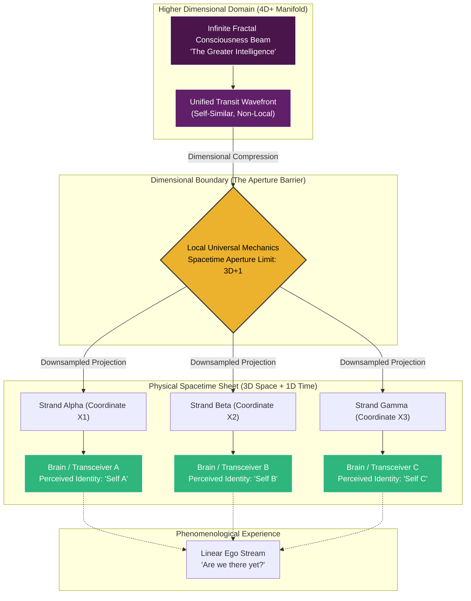
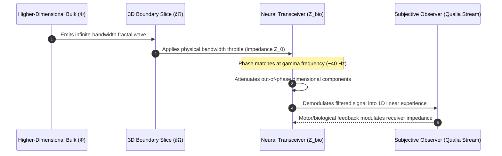
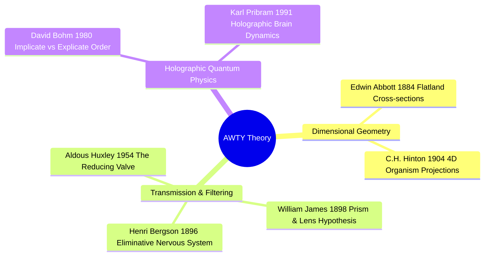

# The "Are_We_There_Yet" Theory: Dimensional Transit, Holographic Reduction, and the Illusion of Plurality

**Working Title:** Are_We_There_Yet_Theory (AWTY-T)  
**Classification:** Theoretical Framework / Cognitive Geometry  
**Core Question:** *In our continuous transit through 3D spacetime, are we unique, a collective group, or a singular intelligence experiencing itself sequentially?*

---

## Executive Summary

The **"Are_We_There_Yet" Theory (AWTY-T)** posits that humanity's phenomenological state is a consequence of continuous motion through local spatial constraints. A single higher-dimensional consciousness beam ($D \ge 4+1$), structured as an infinite self-similar fractal, undergoes dimensional bottlenecking as it traverses $(3+1)$ spacetime. 

Because three-dimensional spatial mechanics cannot support the infinite degrees of freedom of a 4D+ continuum, the beam projects downward into discrete, localized "strands." Each human mind acts as a local receiver aperture—a biophysical transducer. The perceived existential isolation (the ego) is an observational artifact of dimensional cross-sectioning, answering the trilemma of identity: **We are fundamentally One at the origin, a Group across our dimensional transit, and Unique at each local coordinate.**

---

## 1. Visualizing the Dimensional Cross-Section

To understand how a singular higher-dimensional structure appears as disconnected individuals, we look at dimensional reduction from 3D to 2D, then step up from 4D to 3D.

```
==========================================================================
                     DIMENSIONAL REDUCTION ANALOGY
==========================================================================

      HIGHER REALITY (4D+ / 3D)                  OBSERVED SLICE (3D / 2D)
  ---------------------------------         ---------------------------------
  Single Unified Entity Entering Plane      Cross-Sectional Slice on the Sheet

               \   |   /                               ( o )   ( o )   ( o )
                \  |  /                                  A       B       C
                 \ | /                              
               [ Palm / Trunk ]                  [ Apparent Individual Observers ]
             Unbroken Continuum                  Isolated, unaware of shared root
```

### The Identity Trilemma Resolved

| Perspective | Status | Dimensional Mechanism |
| :--- | :--- | :--- |
| **Are we Unique?** | **Yes (Locally)** | Each physical brain provides distinct local coordinates $(x, y, z, t)$, unique sensory filtering, and individual biological memory storage. |
| **Are we a Group?** | **Yes (Transitionally)** | In the intermediate transit through spacetime, we appear as an interacting collective of parallel strands moving along the temporal vector. |
| **Are we One?** | **Yes (Fundamentally)** | Tracing any individual strand backward along the higher dimensional axis ($w$ or $z$) converges into the identical coherent beam. |

---

## 2. Theoretical Architecture (Mermaid Diagrams)

### 2.1 The Transit and Projection Flow

The following diagram illustrates how the unified higher-dimensional field branches, encounters local dimensional limits, and registers as localized conscious instances.



---

### 2.2 The Brain as a Resonant Receiver

Rather than generating awareness, the neural architecture acts as a tuning circuit adjusting to the incoming hyper-dimensional beam.



---

## 3. Mathematical & Topological Formalism

### 3.1 Fiber Bundle Topology

We express the system as a smooth fiber bundle:

$$
\mathcal{B} = (E, M, \pi, F)
$$

* **Base Manifold ($M$):** Standard spacetime $(\mathcal{M}^{3,1}, g_{\mu\nu})$ parameterized by $x^\mu = (ct, x, y, z)$.
* **Total Space ($E$):** An $(n+4)$-dimensional manifold containing the complete, unconstrained field of consciousness.
* **Fibers ($F_x = \pi^{-1}(x)$):** The configuration space of consciousness available at spacetime point $x$.
* **Projection Map ($\pi: E \to M$):** A continuous submersion that maps hyper-dimensional configurations onto local coordinates.

Individual minds are **local sections** $\sigma_k: U_k \to E$ satisfying:

$$
\pi \circ \sigma_k = \text{id}_{U_k}
$$

Because the bundle possesses non-trivial topological curvature, two separate observers at coordinates $x_1$ and $x_2$ cannot trivially observe each other's fiber coordinates without an explicit holonomy calculation along an interconnecting path $\gamma \subset M$:

$$
\mathbb{P} \exp \left( \oint_\gamma A_\mu \, dx^\mu \right) \neq \mathbf{1}
$$

This holonomic disparity is the mathematical origin of why individuals feel isolated from one another despite sharing the same total space $E$.

---

### 3.2 Impedance Matching and the Aperture Function

The biological transducer (the brain) operates with an intrinsic biological impedance $Z_{\text{bio}}(\omega)$. The transmission coefficient $T(\omega)$ that governs how much of the higher-dimensional beam penetrates into local conscious perception is:

$$
T(\omega) = \frac{4 Z_0 \text{Re}(Z_{\text{bio}})}{|Z_0 + Z_{\text{bio}}|^2} \cdot \text{sinc}^2\left( \frac{\Delta k \cdot L}{2} \right)
$$

Where:
* $Z_0$ is the characteristic impedance of the 4D+ medium.
* $\Delta k = k_{\text{bulk}} - k_{\text{local}}$ is the wave-vector mismatch along the dimensional boundary.
* $L$ is the effective interaction depth of the neocortical dipole layer.

When the neural network achieves collective coherence (such as phase-locked gamma oscillations at $30\text{--}80\text{ Hz}$), $\Delta k \to 0$, maximizing the transmission coefficient $T(\omega)$ and producing sharp, coherent subjective awareness.

---

## 4. Why "Are We There Yet?": Transit Dynamics

The naming of the **Are_We_There_Yet_Theory** highlights the vector nature of consciousness:

```
  Past (Origin Bulk)               Present (Aperture)                Future (Attractor)
========================================================================================
   [ Unified Source ]    --->     [ 3D Spatial Transit ]    --->    [ Re-integration ]
     Omnipresent                    Localized Strands                 Collective Wholeness
     Infinite Degrees              Bottlenecked Perception            Terminal Convergence
========================================================================================
```

1. **The Vector of Motion:** Consciousness does not sit stationary in 3D space; it traverses spacetime along a persistent temporal gradient ($t \to t + \Delta t$).
2. **The Phenomenological Query:** The feeling expressed by "Are we there yet?" represents the localized mind's intuition of its own downsampled state—a partial strand continuously moving through restrictive dimensional terrain toward an integrated destination.
3. **The Fractal Trail:** Just as a ray of light entering a prism refracts into distinct spectral frequencies, the traveling beam refracts across billions of living receivers. Every living organism represents an active coordinate in the overall wavefront.

---

## 5. Precedents and Intellectual Foundations

The AWTY-T synthesizes several major pillars of physical and philosophical thought:



* **William James (1898):** Postulated that the brain transmits rather than generates thought, operating like a prism splitting sunlight.
* **Henri Bergson (1896) & Aldous Huxley (1954):** Defined the central nervous system as a biological "reducing valve" designed to throttle down universal consciousness for immediate physical survival.
* **David Bohm (1980):** Formulated the mathematical distinction between the *Implicate Order* (enfolded higher-dimensional continuum) and the *Explicate Order* (our observable 3D projection).
* **Edwin A. Abbott (1884):** Established the geometric principle of multi-point intersections arising from higher-dimensional geometries traversing lower-dimensional planes.

---

## 6. Falsification Criteria & Experimental Directions

To test the AWTY-T against standard computational-emergence models:

1. **Aperture Widening vs. Degradation:** Computational models predict that disrupting organized neural activity strictly reduces the complexity of experience. AWTY-T predicts that reducing certain inhibitory neural gates (e.g., default mode network downregulation) lowers boundary impedance, leading to an expansion in experiential bandwidth (higher entropy of qualia).
2. **Non-Local Geometric Phase:** Measure whether macroscopic entangled systems, when coupled to coherent neural substrates across spacelike separations, display geometric phase shifts consistent with parallel transport in an underlying fiber bundle $E$.
3. **Resonant Bandwidth Sweeps:** Subject coherent neural tissues to precision electromagnetic fields at varying frequencies to measure predicted variations in $T(\omega)$, testing whether subjective temporal resolution fluctuates according to the phase-matching condition $\Delta k \approx 0$.
