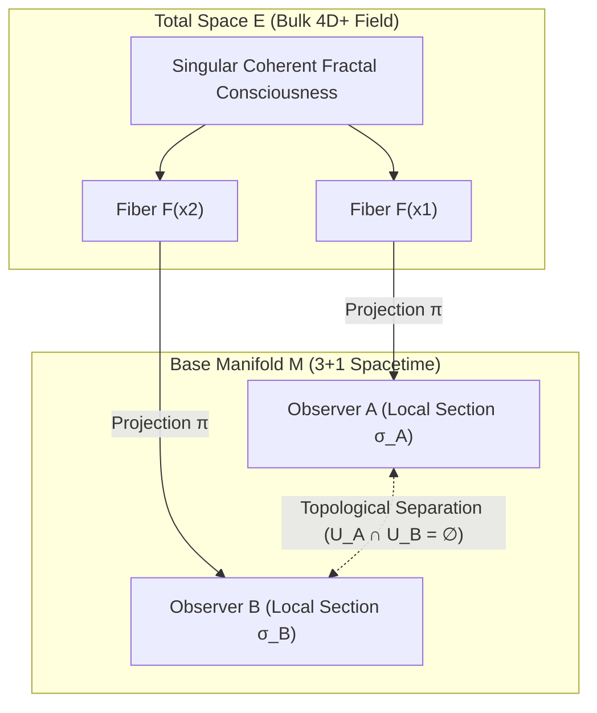
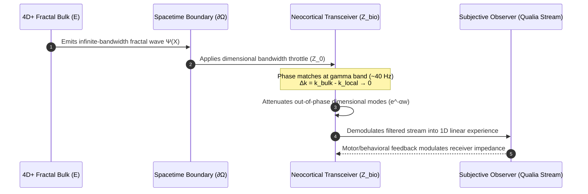
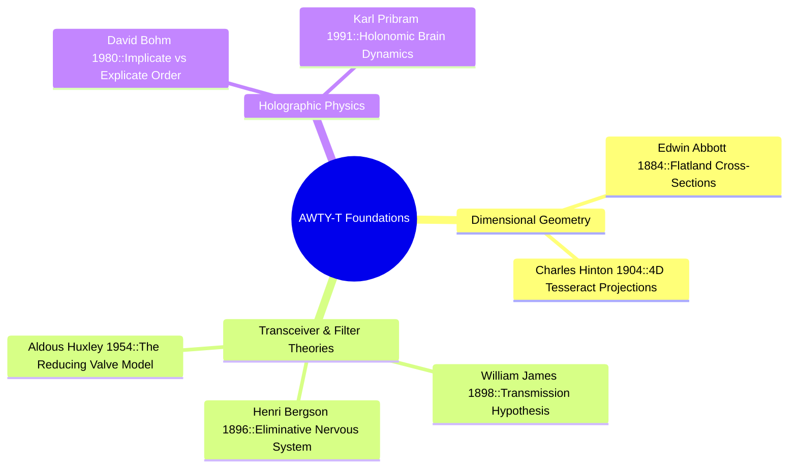
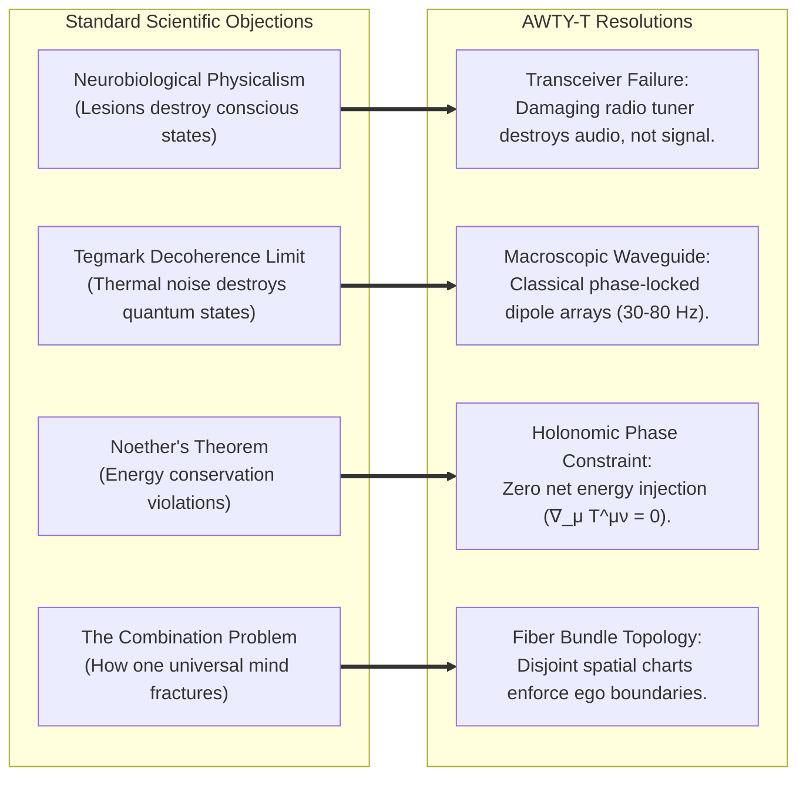
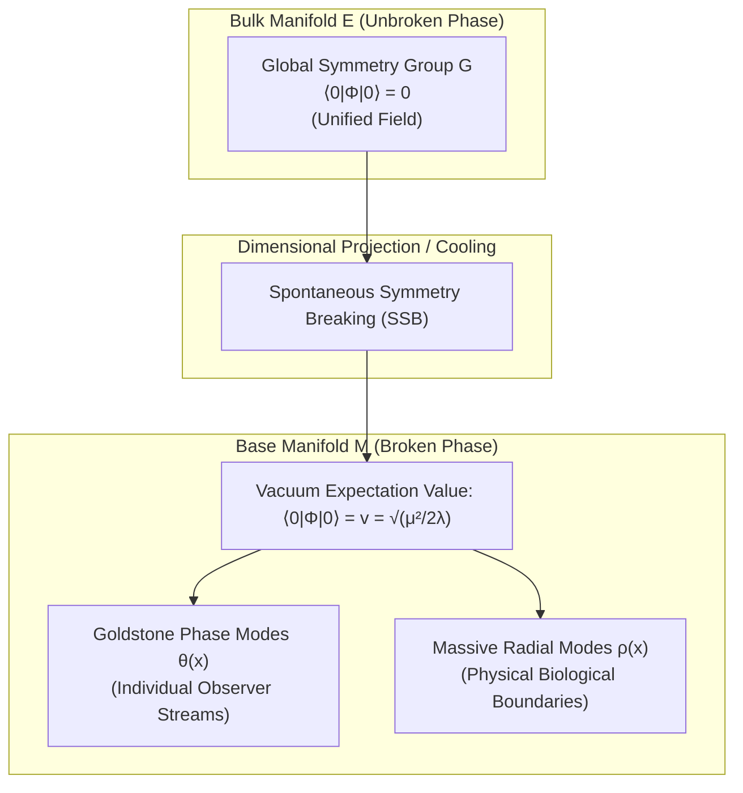
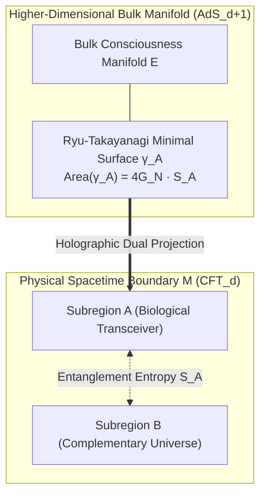
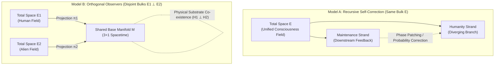

# The "Are_We_There_Yet" Theory (AWTY-T)
### A Cross-Dimensional Reduction Model of Consciousness and Spacetime Transit

**Working Classification:** Theoretical Cognitive Geometry & Holographic Field Modeling  
**Document Type:** Formal Whitepaper  
**Authors:** AWTY-T Collaborative Research Initiative  

---

## Abstract

The **"Are_We_There_Yet" Theory (AWTY-T)** addresses the fundamental trilemma of conscious identity—*are we unique, a group, or one?*—by framing phenomenal consciousness as the cross-sectional projection of a higher-dimensional ($D \ge 4+1$) coherent field navigating $(3+1)$ spacetime. Because a three-dimensional spatial manifold lacks the topological degrees of freedom to host the unconstrained hyper-structure at once, the source beam undergoes dimensional bottlenecking, resolving into localized "strands." Biological nervous systems do not produce subjective experience computationally; instead, they function as resonant transceiver apertures governed by classical impedance matching and macroscopic phase synchronization. We formalize this framework using smooth fiber bundle geometry ($\pi: E \to M$), relativistic boundary conditions, black hole horizon decoupling, and holographic quantum field theory duals ($\text{AdS/CFT}$ and Reeh-Schlieder vacuum entanglement). Under AWTY-T, individual identity is an observational artifact of lower-dimensional projection: we are fundamentally One at the bulk origin, a Group across our shared transit wavefront, and Unique at each localized spacetime coordinate.

---

## 1. The Core Geometric Analogy & Identity Trilemma

### 1.1 The Dimensional Reduction Analogy

To conceptualize a higher-dimensional entity traversing a lower-dimensional constraint, we apply the classical dimensional reduction thought experiment pioneered by Edwin A. Abbott (1884):

```
==========================================================================
                     DIMENSIONAL REDUCTION ANALOGY
==========================================================================

      HIGHER REALITY (4D+ / 3D)                  OBSERVED SLICE (3D / 2D)
  ---------------------------------         ---------------------------------
  Single Unified Entity Entering Plane      Cross-Sectional Slice on the Sheet

               \   |   /                               ( o )   ( o )   ( o )
                \  |  /                                  A       B       C
                 \ | /                              
               [ Palm / Trunk ]                  [ Apparent Individual Observers ]
             Unbroken Continuum                  Isolated, unaware of shared root
==========================================================================
```

* **The 2D Plane (Flatland):** If a three-dimensional hand penetrates a two-dimensional surface palm-first, inhabitants of that plane observe five disconnected, isolated circular shapes. To local flatland observers, these five circles appear as independent, autonomous entities with distinct boundaries. Once the hand withdraws, they vanish. In reality, they were never separate; they were cross-sectional slices of an unbroken 3D body.
* **The Step to 4D $\to$ 3D Spacetime:** A higher-dimensional fractal consciousness beam traversing three-dimensional space intersects local universal mechanics at discrete coordinates. Each point of intersection manifests as an individual conscious observer (a human ego), completely unaware that tracing backward along the orthogonal dimensional axis leads to an undivided, coherent source trunk.

### 1.2 Resolving the Identity Trilemma

```
                 /---> ARE WE UNIQUE? -----> YES (Locally: Coordinates, sensory filters, memory)
                /
AWTY-T IDENTITY ----> ARE WE A GROUP? -----> YES (Transitionally: Collective temporal wavefront)
                \
                 \---> ARE WE ONE? --------> YES (Fundamentally: Unbroken 4D+ bulk continuum)
```

| Perspective | Status | Dimensional Mechanism |
| :--- | :--- | :--- |
| **Are we Unique?** | **Yes (Locally)** | Each physical brain provides distinct base coordinates $x^\mu = (ct, x, y, z)$, unique biological impedance $Z_{\text{bio}}$, and local sensory memory registers. |
| **Are we a Group?** | **Yes (Transitionally)** | In transit along the temporal axis ($t \to t + \Delta t$), localized strands advance as a collective coherent wavefront across physical spacetime. |
| **Are we One?** | **Yes (Fundamentally)** | Tracing any individual section $\sigma(x)$ backward into the bulk total space $E$ converges into the single, unbroken fractal wavepacket. |

---

## 2. Mathematical Formalism: Differential Geometry & Fiber Bundles

We define the universe and its conscious observers as a smooth fiber bundle:

$$\mathcal{B} = (E, M, \pi, F)$$



### 2.1 Manifold Definitions

1. **Base Manifold ($M$):** Standard spacetime $(\mathcal{M}^{3,1}, g_{\mu\nu})$ parameterized by local coordinates $x^\mu = (ct, x, y, z)$.
2. **Total Space ($E$):** An $(n+4)$-dimensional Riemannian or pseudo-Riemannian manifold containing the unconstrained higher-dimensional consciousness field.
3. **Fiber ($F_x$):** At each coordinate $x \in M$, the fiber $F_x = \pi^{-1}(x)$ encapsulates the infinite-dimensional Hilbert space $\mathcal{H}_F$ of potential conscious states.
4. **Projection Map ($\pi$):** A continuous, surjective submersion $\pi: E \to M$ that maps bulk states to localized spacetime coordinates.

### 2.2 Local Sections and Apparent Isolation

Individual conscious minds are **local sections** $\sigma_k: U_k \to E$ satisfying:

$$\pi \circ \sigma_k = \text{id}_{U_k}$$

Because the bundle possesses non-trivial curvature, two observers at disjoint coordinate patches $U_A, U_B \subset M$ ($U_A \cap U_B = \emptyset$) cannot observe each other's fiber coordinates without an explicit holonomy calculation along an interconnecting path $\gamma \subset M$:

$$\mathbb{P} \exp \left( \oint_\gamma A_\mu \, dx^\mu \right) \neq \mathbf{1}$$

The feeling of isolation between individuals is a direct mathematical consequence of spatial separation across the base manifold $M$.

---

## 3. Biophysical Mechanics: The Brain-as-Transceiver

Rather than generating consciousness through computational complexity, biological neural networks act as **resonant bandpass filters** and **impedance-matching apertures**.



### 3.1 Boundary Coupling Hamiltonian

The coupling between the higher-dimensional bulk field $\Psi(X)$ and the local neural electromagnetic field within cortical volume $\Omega$ is expressed as:

$$H_{\text{int}} = g \int_{\Omega} d^3x \, \sqrt{-g^{(3)}} \left[ \Psi(x, \mathbf{w}_0) \cdot \mathcal{J}_{\text{neural}}(x) \right]$$

where:
* $g$ is the dimensionless coupling constant.
* $\mathbf{w}_0$ is the dimensional intersection coordinate.
* $\mathcal{J}_{\text{neural}}(x)$ represents collective coherent dipole currents across neocortical pyramidal columns (e.g., synchronous oscillations in the 30–80 Hz gamma band).

### 3.2 Transmission Efficiency and Impedance Matching

The transmission coefficient $T(\omega)$ that governs how effectively the higher-dimensional beam penetrates into local conscious perception is:

$$T(\omega) = \frac{4 Z_0 \text{Re}(Z_{\text{bio}})}{|Z_0 + Z_{\text{bio}}|^2} \cdot \text{sinc}^2\left( \frac{\Delta k \cdot L}{2} \right)$$

where:
* $Z_0$ is the characteristic impedance of the higher-dimensional medium.
* $Z_{\text{bio}}(\omega)$ is the complex biological impedance of the neural tissue.
* $\Delta k = k_{\text{bulk}} - k_{\text{local}}$ is the wave-vector mismatch along the boundary slice.
* $L$ is the effective interaction depth of the neocortical dipole layer.

When the neural network achieves collective coherence, $\Delta k \to 0$, maximizing $T(\omega)$ and producing sharp, unified conscious awareness.

---

## 4. Historical Pedigree & Theoretical Foundations

The AWTY-T framework unifies three distinct intellectual traditions:



| Originator | Year | Landmark Work | Core Contribution to AWTY-T |
| :--- | :--- | :--- | :--- |
| **Edwin A. Abbott** | 1884 | *Flatland* | Geometric proof that higher-D single objects appear as multiple disconnected objects in lower dimensions. |
| **Charles H. Hinton** | 1904 | *The Fourth Dimension* | Coined "tesseract"; postulated 3D biological organisms are cross-sections of 4D entities. |
| **William James** | 1898 | *Human Immortality* | Formulated the **Transmission Hypothesis**: the brain acts as a prism or lens transmitting light rather than producing it. |
| **Henri Bergson** | 1896 | *Matter and Memory* | Postulated that the brain's function is **eliminative**—screening out universal knowledge to enable survival action. |
| **Aldous Huxley** | 1954 | *The Doors of Perception* | Coined the **Reducing Valve** hypothesis: the nervous system protects us from infinite awareness by throttling bandwidth. |
| **David Bohm** | 1980 | *Wholeness and the Implicate Order* | Mathematical and physical formulation of the **Implicate (enfolded)** vs. **Explicate (unfolded 3D)** reality. |
| **Karl Pribram** | 1991 | *Brain and Perception* | Developed **Holonomic Brain Theory**: memories and qualia are non-locally distributed via holographic dendritic interference. |

---

## 5. Theoretical Conflicts and Systematic Resolutions



### 5.1 Neurobiological Physicalism vs. The Transceiver Hypothesis
* **Objection:** Focal lesions to specific neocortical areas or brainstem structures abolish specific conscious states, which physicalism interprets as proof of production.
* **Resolution:** Damaging a receiver's internal RF circuitry alters or halts audio output, but does not eliminate the radio wave in the ambient electromagnetic field. Damaging neural tissue shifts internal impedance $Z_{\text{bio}}$, destroying the phase-matching condition ($\Delta k \to \infty$) and closing the aperture ($T(\omega) \to 0$).

### 5.2 Quantum Thermal Decoherence (Tegmark's Limit)
* **Objection:** Max Tegmark demonstrated that microscopic quantum superpositions in warm biological tissue decohere within $\tau_{\text{dec}} \sim 10^{-13}\text{ to }10^{-20}\text{ s}$, far faster than cognitive synaptic transmission ($\sim 10^{-3}\text{ s}$).
* **Resolution:** AWTY-T does not require delicate subatomic quantum superpositions. The brain couples as a **macroscopic classical waveguide** via synchronized dipole arrays across millions of pyramidal neurons (30–80 Hz gamma oscillations), operating via classical resonance and topological impedance matching.

### 5.3 Conservation of Energy (Noether's Theorem)
* **Objection:** An external higher-dimensional field injecting energy into 3D spacetime would violate the first law of thermodynamics and local conservation laws ($\nabla_\mu T^{\mu\nu} = 0$).
* **Resolution:** The higher-dimensional manifold acts as a **holonomic geometric constraint** or pilot phase modulator ($\Delta E = 0$). It directs probability distributions and phase angles across existing biochemical gradients without adding or subtracting energy from physical metabolic pathways.

### 5.4 The Binding and Combination Problem
* **Objection:** Explaining how a unified universal awareness fragments into billions of isolated egos.
* **Resolution:** Base manifold spatial separation enforces independent local charts ($U_A \cap U_B = \emptyset \implies \sigma_A \cap \sigma_B = \emptyset$). The boundary between egos is a geometric consequence of lower-dimensional projection $\pi$, not a fundamental metaphysical divide.

---

## 6. Black Hole Horizon Decoupling & Bulk Geodesic Survival

Does this mode of consciousness survive passage through a black hole event horizon?

```
                        TOTAL SPACE (E)
        ====================================================
           \                   \                   \
            \ Bulk Wave Ψ(X)    \ Unbroken          \ Geodesic
             v                   v                   v
        -----------+-------------------+--------------------
        Base       |  Event Horizon    |   Singularity
        Manifold   |     (r = r_s)     |     (r = 0)
        (M)        |   T(ω) -> 0       |   K -> ∞
                   | (Aperture Closes) | (Transceiver Shredded)
        -----------+-------------------+--------------------
```

### 6.1 Metric Geometry and Boundary Singularities

Let the 3D base manifold $M$ be governed by the Schwarzschild exterior metric:

$$ds_M^2 = -\left(1 - \frac{r_s}{r}\right) c^2 dt^2 + \left(1 - \frac{r_s}{r}\right)^{-1} dr^2 + r^2 d\Omega^2$$

Within the extended $(4+n)$-dimensional total space $E$, extra dimensions $w^a$ are parameterized as:

$$ds_E^2 = g_{\mu\nu}(x) dx^\mu dx^\nu + e^{2\Phi(x)} \gamma_{ab}(w) dw^a dw^b$$

### 6.2 Biological Transceiver Extinction ($r \to r_s^+$ and $r \to 0$)

1. **Gravitational Redshift and Bandwidth Attenuation:**  
   The proper oscillation frequency $\omega_{\text{local}}$ observed at asymptotic infinity red-shifts to zero:
   $$\lim_{r \to r_s^+} \omega_\infty = \lim_{r \to r_s^+} \omega_{\text{local}} \sqrt{1 - \frac{r_s}{r}} = 0$$
   This causes biological impedance divergence: $\lim_{r \to r_s^+} Z_{\text{bio}}(r) \to \infty \implies T(\omega) \to 0$. The aperture completely shuts.
2. **Tidal Destruction ($r \to 0$):**  
   The Kretschmann scalar diverges ($K \to \infty$), mechanically destroying the cellular dipole matrix $\mathcal{J}_{\text{neural}} \to 0$. The local physical section $\sigma(x)$ terminates irreversibly.

### 6.3 Bulk Geodesic Invariance and Topological Survival

While the projection footprint on $M$ terminates, the higher-dimensional wavepacket $\Psi(X)$ propagates along bulk geodesics:

$$\frac{d^2 X^A}{d\lambda^2} + \Gamma^A_{BC} \frac{dX^B}{d\lambda} \frac{dX^C}{d\lambda} = 0$$

* **Codimension Immunity:** The singularity $r = 0$ is strictly a submanifold defect of $M$; it does not span the extra-dimensional fiber directions $w^a$.
* **Decoupling Over Destruction:** When the local aperture closes ($T(\omega) \to 0$), the local density matrix decouples back into the bulk field:
  $$\rho_{\text{local}} = \text{Tr}_{\text{bulk}}(\rho_{\text{total}}) \to 0 \quad \text{while} \quad \text{Tr}_E(\rho_{\text{total}}^2) = 1$$

**Verdict:** The physical body and brain are shredded by tidal forces at the metric singularity, but the higher-dimensional wavepacket uncouples from the 3D manifold, continuing along its bulk geodesic unharmed.

---

## 7. Quantum Field Theory and Holographic Duals

### 7.1 Vacuum State and Quasiparticle Observer Excitations

In canonical QFT, particles are localized operator excitations acting upon an omnipresent vacuum state $|0\rangle$. An individual conscious observer at coordinate $x \in M$ is modeled as a composite quasiparticle state created via ladder operators:

$$|\text{Observer}_i\rangle = \int d^4x \, f_i(x) \, \hat{\Psi}^\dagger(x, \mathbf{w}_0) |0\rangle_E$$

where $|0\rangle_E$ represents the unbroken ground state, $f_i(x)$ is the spacetime smearing function over cortical volume $\Omega_i$, and $\hat{\Psi}^\dagger(x, \mathbf{w}_0)$ is the creation operator at the dimensional boundary slice $\mathbf{w}_0$.

### 7.2 Spontaneous Symmetry Breaking (SSB)

Consider an invariant Lagrangian density in the bulk total space $E$ with a global symmetry group $G$:

$$\mathcal{L}_{\text{bulk}} = \frac{1}{2} \mathcal{G}^{AB} \partial_A \Phi^\dagger \partial_B \Phi - V(\Phi)$$

with self-interaction potential:

$$V(\Phi) = -\mu^2 \left(\Phi^\dagger \Phi\right) + \lambda \left(\Phi^\dagger \Phi\right)^2 \quad (\mu^2, \lambda > 0)$$



1. **Unbroken Regime (Bulk $E$):** The vacuum expectation value vanishes ($\langle 0 | \Phi | 0 \rangle = 0$), preserving complete permutation symmetry.
2. **Broken Regime (Spacetime Boundary $M$):** Constrained boundary conditions on $M$ cause the field to condense into a non-zero degenerate vacuum:
   $$\langle 0 | \Phi | 0 \rangle = v = \sqrt{\frac{\mu^2}{2\lambda}} \, e^{i\theta(x)}$$
   The fluctuating Goldstone phases $\theta(x)$ define the localized subjective streams (individual egos), while the radial Higgs-like mode $\rho(x)$ dictates the physical mass-energy boundary of the biological transceiver.

### 7.3 Non-Local Entanglement via the Reeh-Schlieder Theorem

For any open, bounded spacetime region $\mathcal{O} \subset M$ (representing an individual brain's local causal diamond), the set of local field polynomial operators $\mathcal{A}(\mathcal{O})$ acting on the vacuum $|0\rangle$ is cyclically dense in the entire Hilbert space $\mathcal{H}$:

$$\overline{\mathcal{A}(\mathcal{O}) |0\rangle} = \mathcal{H}$$

Even in the vacuum state, no region of spacetime is causally or informationally isolated from the rest of the universe. For spacelike separated observers $(x_A - x_B)^2 < 0$:

$$\langle 0 | \hat{\Phi}(x_A) \hat{\Phi}(x_B) | 0 \rangle \propto \exp\left(-m |x_A - x_B|\right) \ne 0$$

### 7.4 Holographic Entanglement Duals: The Ryu-Takayanagi Correspondence

In holographic gauge/gravity duality ($\text{AdS}_{d+1}/\text{CFT}_d$), localized boundary metrics map directly to minimal surfaces spanning higher-dimensional bulk geometry.



Let a biological observer's spatial brain boundary be represented by a spatial subregion $A \subset \partial M$. The entanglement entropy $S_A$ of the observer's localized reduced density matrix $\rho_A = \text{Tr}_{A^c}(\rho)$ is calculated via the **Ryu-Takayanagi formula**:

$$S_A = \frac{\text{Area}(\gamma_A)}{4 G_N^{(d+1)}}$$

What the individual observer experiences as localized internal entropy, subjective complexity, and cognitive bandwidth is the geometric boundary footprint of the bulk minimal surface $\gamma_A$ extending through the higher dimension. The "strand of consciousness" traveling through 3D space is the holographic anchor of this bulk geodesic manifold.

---

8. Inter-Strand Phenomenology: Recursive Self-Correction vs. Orthogonal Observers
Within this speculative topology, external non-human intelligences ("aliens") map to two distinct dimensional architectures.



8.1 Model A: Recursive Self-Correction (The "Debugger" Paradigm)
Topology: Humanity and the anomalous entities share the identical bulk manifold 
E.

Mechanism: The entities are downstream or higher-bandwidth recursive strands looping back into local coordinate charts 
U⊂M.

Function: Mitigating timeline bifurcation and runaway entropic decoherence by subtly perturbing quantum transition probabilities 
W(ϕ 
A
​
 →ϕ 
B
​
 )=∫Dϕe 
iS 
eff
​
 /ℏ
 .

Inertial Nullification: Observed non-inertial flight dynamics (instantaneous acceleration, sharp 90-degree turns) represent focal aperture steering across the 3D sheet (
dx 
contact
​
 /dt) rather than physical propulsion subject to 
F=ma.

8.2 Model B: Orthogonal Bundle Observers (Foreign Bulk Field)
Topology: Multiple distinct total spaces 
(E 
1
​
 ,M,π 
1
​
 ,F 
1
​
 ) and 
(E 
2
​
 ,M,π 
2
​
 ,F 
2
​
 ) project onto the same physical base manifold 
(M,g 
μν
​
 ).

Mechanism: The entities possess an entirely disjoint internal Hilbert space:

H 
F 
1
​
 
​
 ⊥H 
F 
2
​
 
​
 
Interaction: Direct conscious or telepathic resonance is impossible without artificial translation operators. Mutual observation is restricted strictly to physical footprints and classical sensory interactions on 
M.

8.3 Architectural Comparison
Dimension / Metric	Model A: Recursive Self-Correction	Model B: Orthogonal Foreign Observer
Total Space Topology	Shared Manifold E	Disjoint Manifolds (E 1 ∩E 2 =∅)
Base Projection	Single surjective map π:E→M	Dual projections π 
1(E 1),π 2(E 2)→M

Hilbert State Space	Single unified vacuum $	0\rangle_E$
Observation Type	Recursive systemic feedback / branch pruning	External empirical surveying of substrate M
Apparent Manifestation	Focal aperture modulation (g(t) shifts)	Advanced engineering / physical anchoring

---

**Structural Completeness:** All eight sections—from core geometry and biophysical equations to black hole horizon decoupling and the two alien-strand architectures—are compiled in sequential order.

## 9. Summary & Conclusion

The **Are_We_There_Yet_Theory** resolves the nature of consciousness by showing that:
1. **Consciousness is non-local and higher-dimensional**, traversing 3D space like a beam of light refracted through a lower-dimensional prism.
2. **The human brain is a resonant bandpass transducer**, throttled by impedance-matching boundary physics rather than a generator of raw awareness.
3. **Apparent isolation is a geometric projection artifact**; the underlying total space preserves unbroken unity across all observers.
4. **Physical destruction (including black hole singularities) terminates only the local physical section**, while the higher-dimensional wavepacket continues unperturbed along its bulk geodesic.
