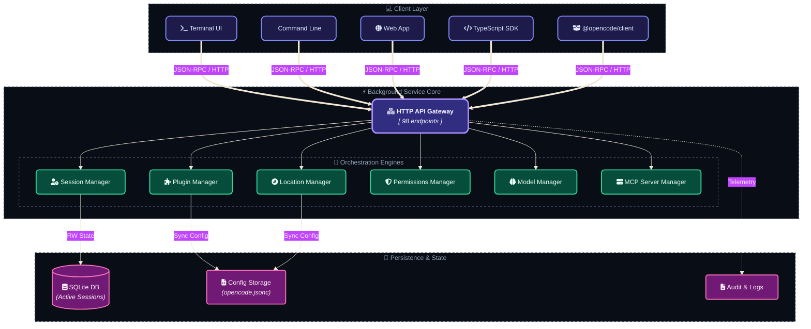
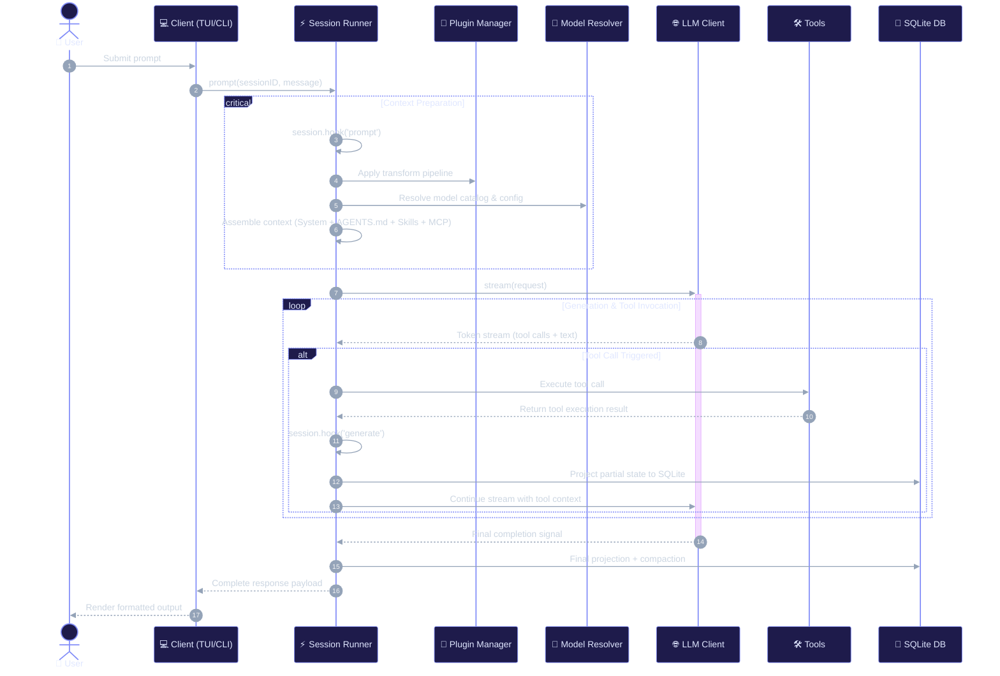
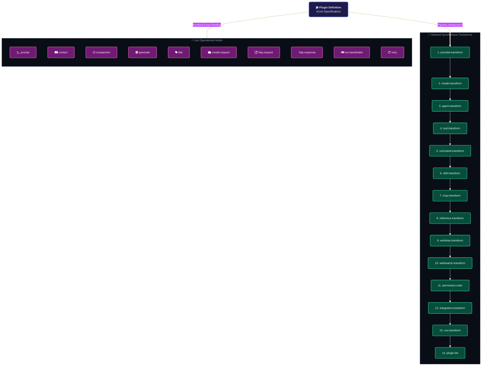
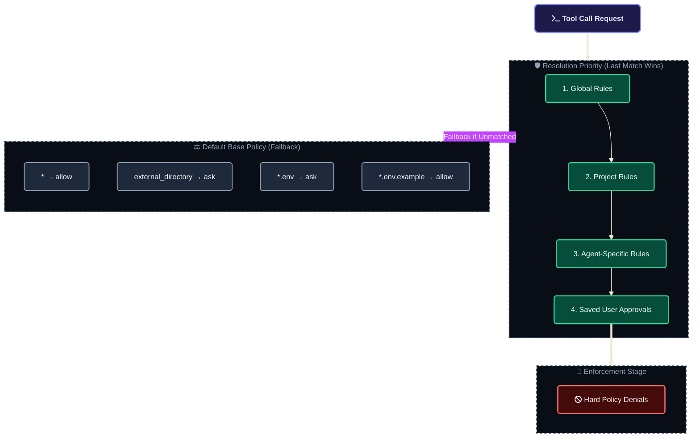

# OpenCode V2 Architecture Flowcharts

## 1. System Architecture Overview



## 2. Session Execution Flow



## 3. Plugin Transform & Hook Pipeline



## 4. Permission Resolution Flow



## 5. Agent Types & Hierarchy

```mermaid
%%{init: {'theme': 'base', 'themeVariables': { 'fontFamily': 'Fira Code, monospace', 'fontSize': '13px', 'darkMode': true, 'background': '#0f172a'}}}%%
flowchart TB
    classDef primary fill:#1e1b4b,stroke:#818cf8,stroke-width:2px,color:#e0e7ff,rx:8px,ry:8px;
    classDef subagent fill:#064e3b,stroke:#34d399,stroke-width:2px,color:#ecfdf5,rx:6px,ry:6px;
    classDef system fill:#334155,stroke:#94a3b8,stroke-width:2px,color:#f8fafc,rx:6px,ry:6px;
    classDef subStyle fill:#090d16,stroke:#334155,stroke-width:1
