# OpenCode V2 Architecture Flowcharts

## 1. System Architecture Overview

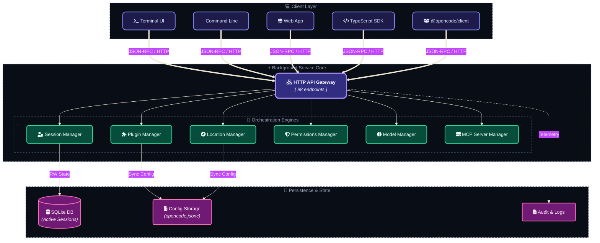

```mermaid
graph TB
    subgraph Clients
        TUI[Terminal UI]
        CLI[Command Line]
        Web[Web App]
        SDK[TypeScript SDK]
        ClientLib[@opencode/client]
    end

    subgraph "Background Service"
        HttpApi[HTTP API<br/>98 operations]
        SessionMgr[Session Manager]
        LocationMgr[Location Manager]
        PluginMgr[Plugin Manager]
        PermMgr[Permissions Manager]
        ModelMgr[Model Manager]
        MCPManager[MCP Server Manager]
    end

    subgraph Storage
        SQLite[(SQLite<br/>Session DB)]
        Config[Config Files<br/>opencode.jsonc]
        Logs[Log Files]
    end

    TUI --> HttpApi
    CLI --> HttpApi
    Web --> HttpApi
    SDK --> HttpApi
    ClientLib --> HttpApi

    HttpApi --> SessionMgr
    HttpApi --> LocationMgr
    HttpApi --> PluginMgr
    HttpApi --> PermMgr
    HttpApi --> ModelMgr
    HttpApi --> MCPManager

    SessionMgr --> SQLite
    PluginMgr --> Config
    LocationMgr --> Config
```

## 2. Session Execution Flow

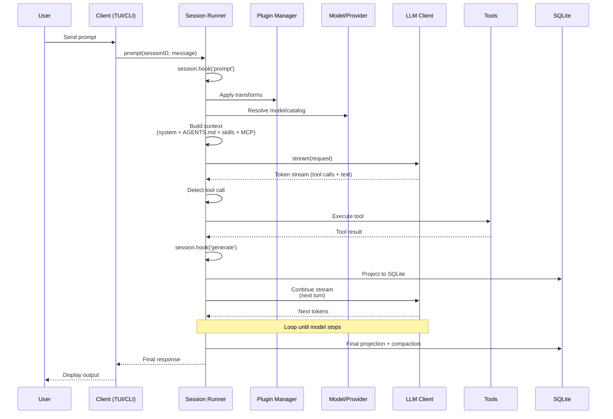

## 3. Plugin Transform & Hook Pipeline

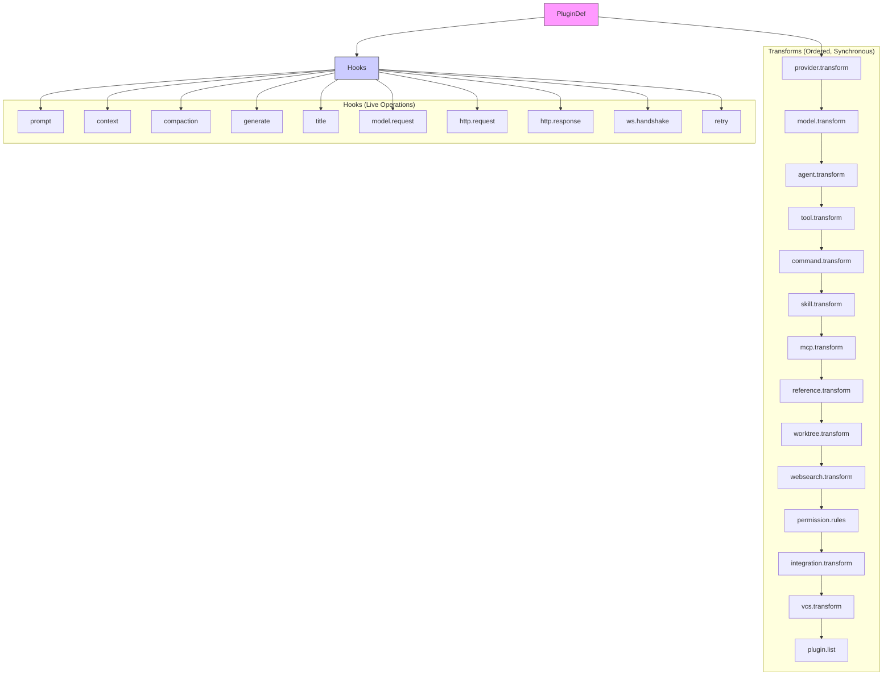

## 4. Permission Resolution Flow

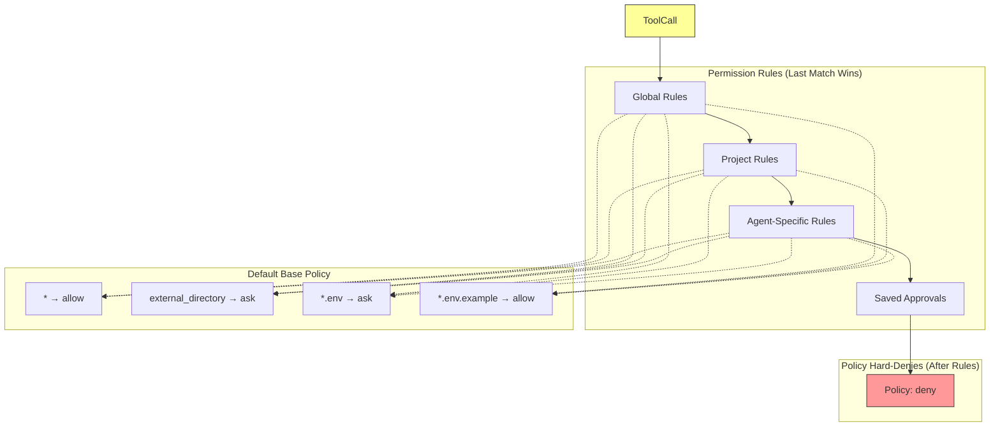

## 5. Agent Types & Hierarchy

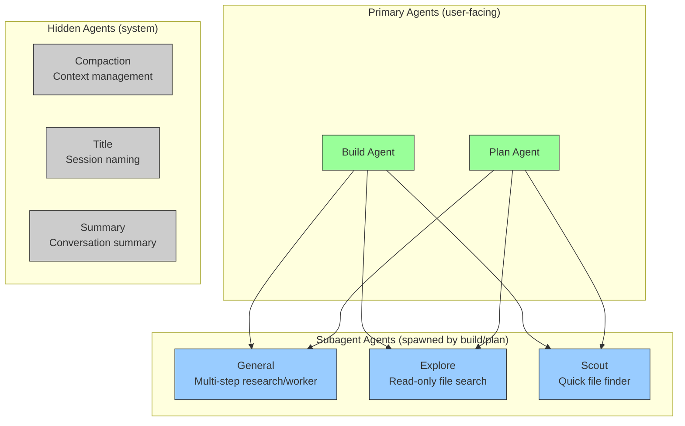

## 6. Subagent Execution Model

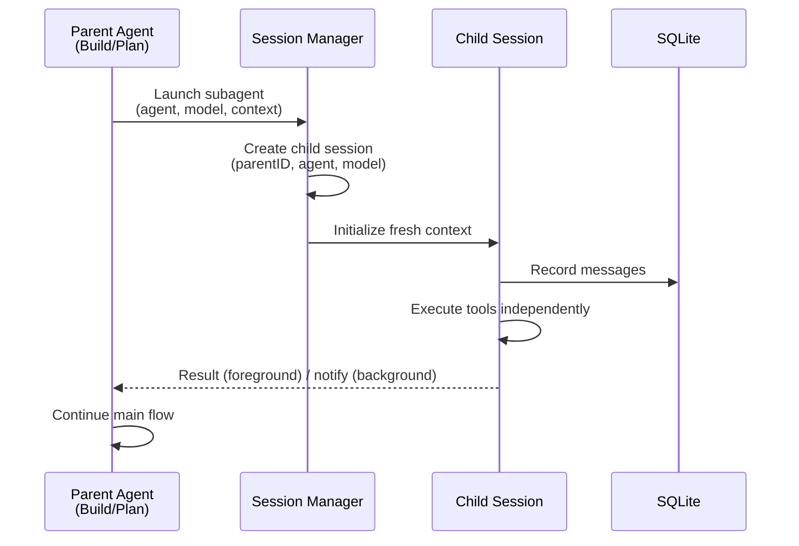

## 7. Context Compaction Flow

```mermaid
graph TB
    subgraph "Detection"
        D1[Token count vs model limit]
        D2[Turn splitting check]
    end

    subgraph "Compaction Process"
        P1[Output pruning]
        P2[Compaction markers]
        P3[Durable barrier]
    end

    subgraph "Compaction Methods"
        M1[Local summary<br/>(SessionCompaction)]
        M2[Native provider compaction]
    end

    D1 --> P1 --> P3 --> M1
    D2 --> P2 --> P3 --> M1
    P3 --> M2

    M1 --> DB[(SQLite)]
    M2 --> DB

    style DB fill:#ccf,stroke:#333
```

## 8. Instruction Resolution Order

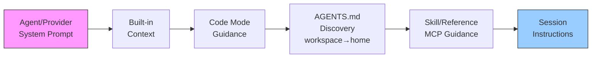

## 9. Location & Service Graph

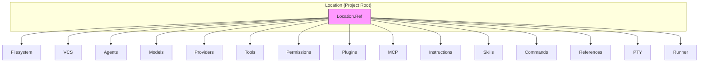

## 10. HTTP API Surface (98 operations)

```mermaid
graph TB
    subgraph "Server"
        S1[info]
        S2[pair]
        S3[connect]
    end

    subgraph "Location"
        L1[get]
        L2[reload]
    end

    subgraph "Agent"
        A1[list]
        A2[get]
    end

    subgraph "Plugin"
        P1[list]
        P2[check]
        P3[update]
    end

    subgraph "Session"
        SE1[list]
        SE2[create]
        SE3[get]
        SE4[remove]
        SE5[update]
        SE6[fork]
        SE7[prompt]
        SE8[interrupt]
        SE9[wait]
        SE10[switchAgent]
        SE11[switchModel]
        SE12[compact]
        SE13[context]
        SE14[import]
        SE15[export]
    end

    subgraph "Other"
        O1[message]
        O2[form]
        O3[question]
        O4[permission]
        O5[file]
        O6[vcs]
        O7[shell]
        O8[pty]
        O9[model]
        O10[provider]
        O11[integration]
        O12[credential]
        O13[mcp]
        O14[skill]
        O15[reference]
        O16[command]
        O17[generation]
        O18[event]
    end

    API[HTTP API] --> S1 & S2 & S3
    API --> L1 & L2
    API --> A1 & A2
    API --> P1 & P2 & P3
    API --> SE1 & SE2 & SE3 & SE4 & SE5 & SE6 & SE7 & SE8 & SE9 & SE10 & SE11 & SE12 & SE13 & SE14 & SE15
    API --> O1 & O2 & O3 & O4 & O5 & O6 & O7 & O8 & O9 & O10 & O11 & O12 & O13 & O14 & O15 & O16 & O17 & O18
```

## 11. Data Persistence: SessionProjector

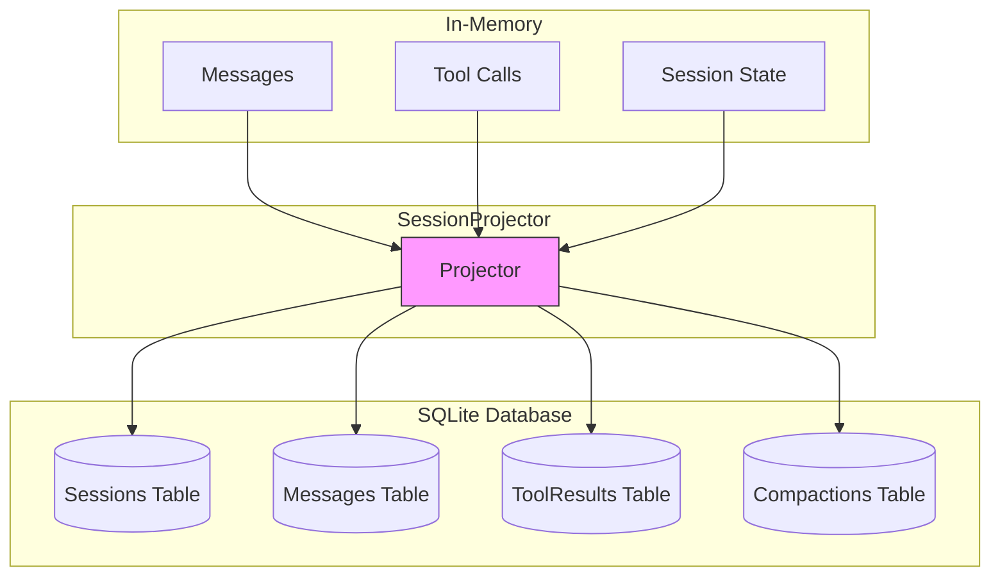

## 12. Tool Execution Pipeline

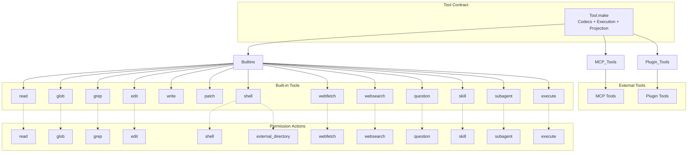

## 13. Worktree Management

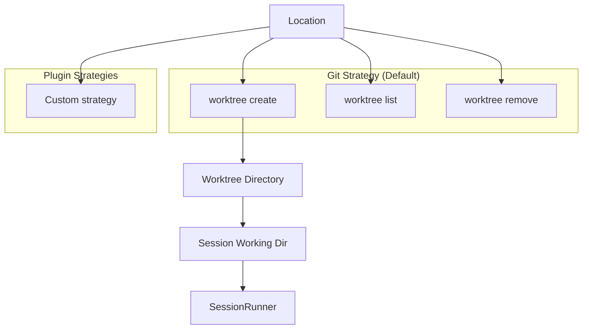

## 14. Event Bus Architecture

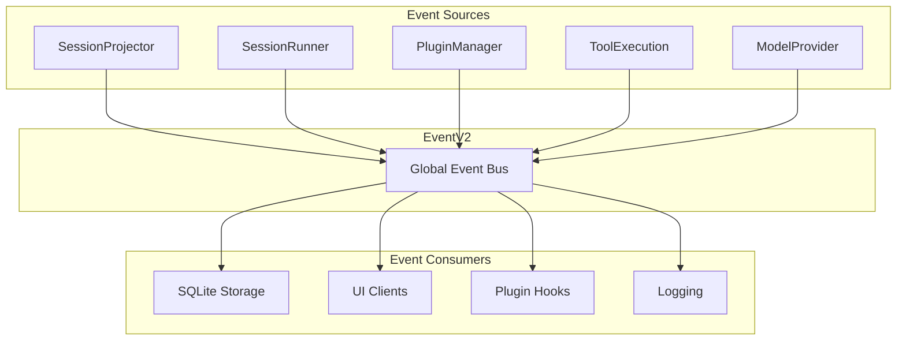

---

*Generated from OpenCode V2 source code and documentation analysis.*
