# OpenCode V2 Architecture Flowcharts

## 1. System Architecture Overview

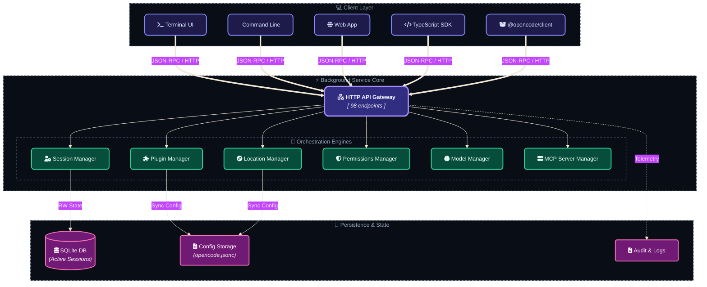

## 2. Session Execution Flow

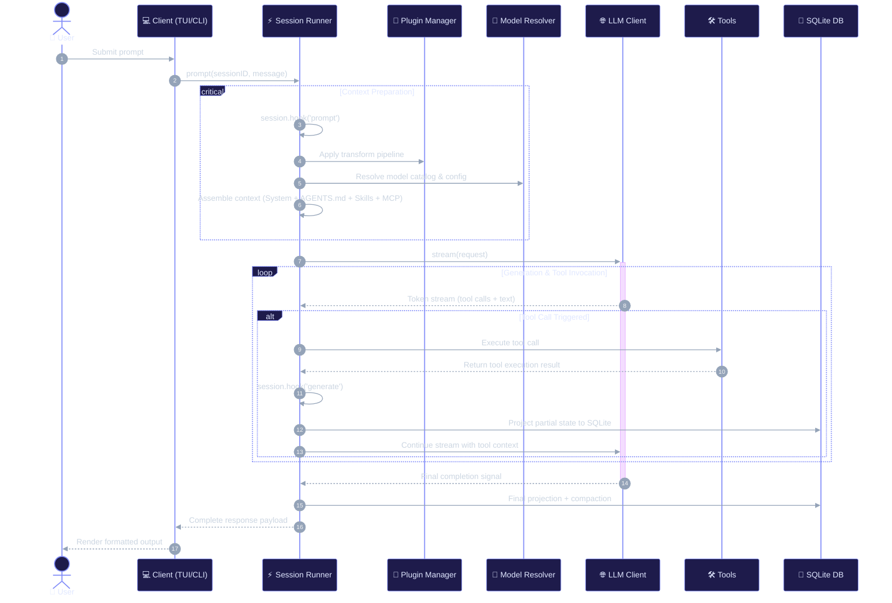

## 3. Plugin Transform & Hook Pipeline

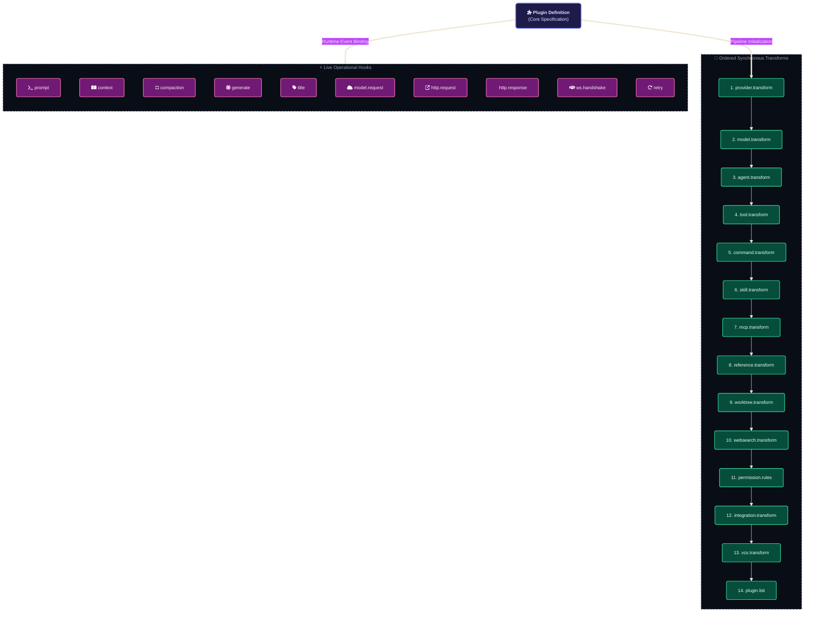

## 4. Permission Resolution Flow

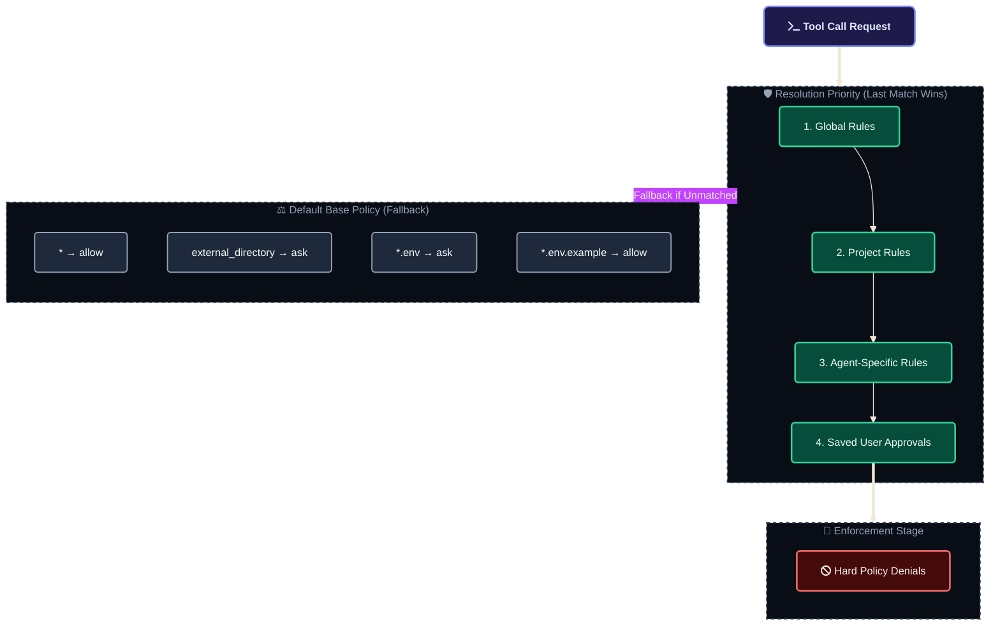

## 5. Agent Types & Hierarchy

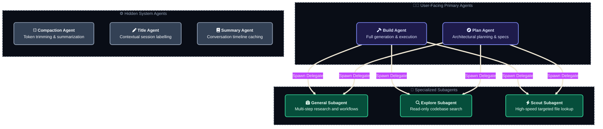

## 6. Subagent Execution Model

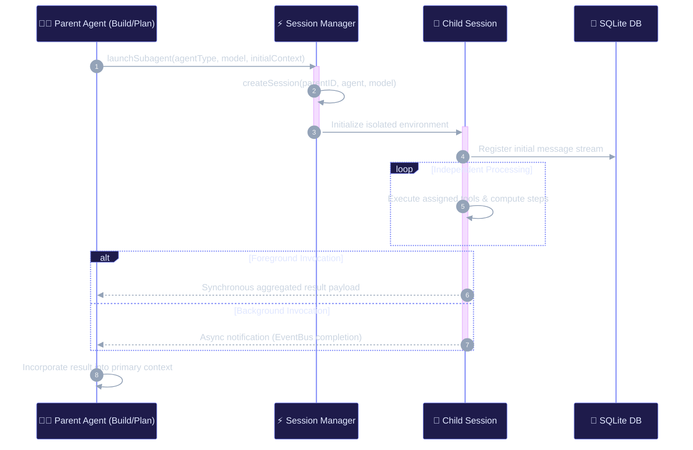

## 7. Context Compaction Flow

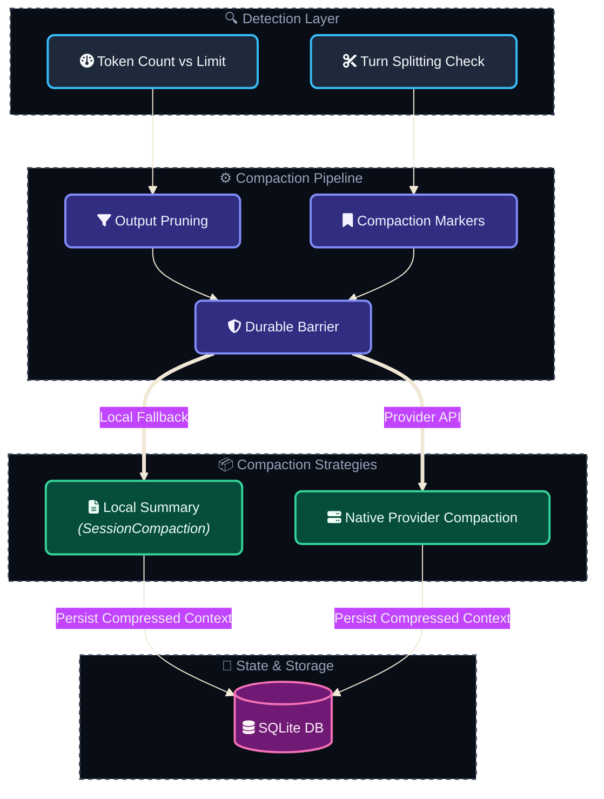

## 8. Instruction Resolution Order

```mermaid
%%{init: {'theme': 'base', 'themeVariables': { 'fontFamily': 'Fira Code, monospace', 'fontSize': '12px', 'darkMode': true, 'background': '#0f172a'}}}%%
flowchart LR
    classDef root fill:#1e1b4b,stroke:#818cf8,stroke-width:2px,color:#e0e7ff,rx:6px,ry:6px;
    classDef step fill:#064e3b,stroke:#34d399,stroke-width:2px,color:#ecfdf5,rx:6px,ry:6px;
    classDef priority fill:#701a75,stroke:#f472b6,stroke-width:2px,color:#fdf2f8,rx:6px,ry:6px;

    I1["fa:fa-gear <b>System Prompt</b><br/>Provider & Agent Base"]:::root
    I2["fa:fa-box <b>Built-in Context</b><br/>Runtime Metadata"]:::step
    I3["fa:fa-code <b>Code Mode</b><br/>Execution Guidance"]:::step
    I4["fa:fa-file-lines <b>AGENTS.md</b><br/>Workspace → Home"]:::step
    I5["fa:fa-puzzle-piece <b>Skills & MCP</b><br/>Dynamic Tools"]:::step
    I6["fa:fa-user-check <b>Session Instructions</b><br/><i>Highest Precedence</i>"]:::priority

    I1 ==>|Pave Base| I2
    I2 ==>|Inject| I3
    I3 ==>|Augment| I4
    I4 ==>|Extend| I5
    I5 ==>|Override| I6
```

## 9. Location & Service Graph

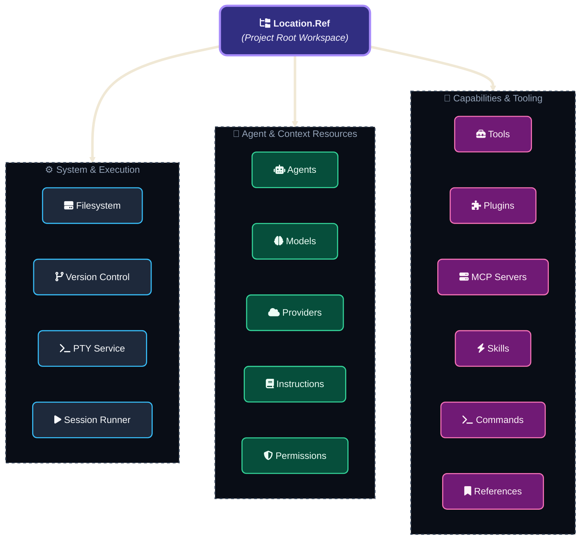

## 10. HTTP API Surface (98 operations)

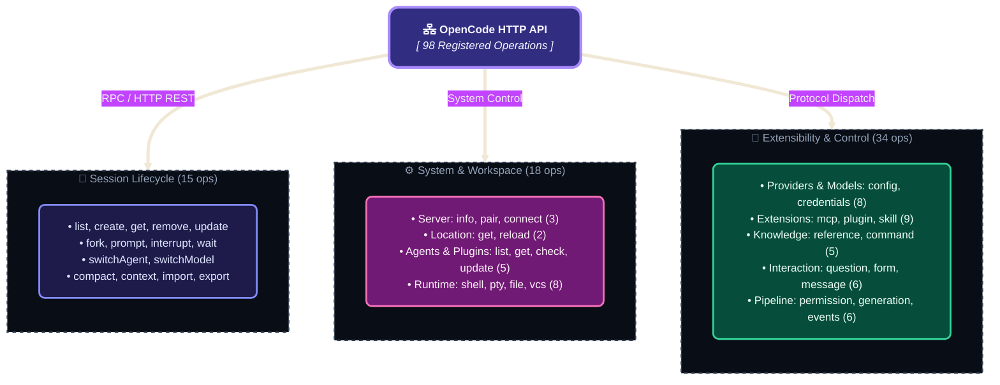

## 11. Data Persistence: SessionProjector

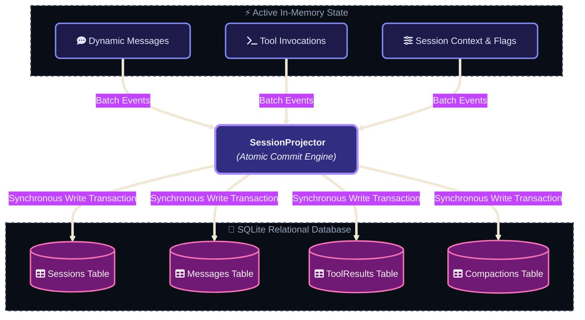

## 12. Tool Execution Pipeline

```mermaid
%%{init: {'theme': 'base', 'themeVariables': { 'fontFamily': 'Fira Code, monospace', 'fontSize': '12px', 'darkMode': true, 'background': '#0f172a'}}}%%
flowchart TB
    classDef contract fill:#312e81,stroke:#a78bfa,stroke-width:2px,color:#f5f3ff,rx:8px,ry:8px;
    classDef tool fill:#1e1b4b,stroke:#818cf8,stroke-width:1.5px,color:#e0e7ff,rx:4px,ry:4px;
    classDef ext fill:#064e3b,stroke:#34d399,stroke-width:1.5px,color:#ecfdf5,rx:4px,ry:4px;
    classDef perm fill:#701a75,stroke:#f472b6,stroke-width:1.5px,color:#fdf2f8,rx:4px,ry:4px;
    classDef subStyle fill:#090d16,stroke:#334155,stroke-width:1.5px,stroke-dasharray: 4 4,color:#94a3b8;

    Make["fa:fa-file-signature <b>Tool.make Contract</b><br/>Codecs • Execution • Projection"]:::contract

    subgraph BUILTINS[" 🛠️ Built-in Capabilities "]
        direction TB
        T1["read"]:::tool
        T2["glob"]:::tool
        T3["grep"]:::tool
        T4["edit"]:::tool
        T5["write"]:::tool
        T6["patch"]:::tool
        T7["shell"]:::tool
        T8["webfetch"]:::tool
        T9["websearch"]:::tool
        T10["question"]:::tool
        T11["skill"]:::tool
        T12["subagent"]:::tool
        T13["execute"]:::tool
    end

    subgraph EXTERNAL[" 🌐 External Tools "]
        direction TB
        M1["fa:fa-server MCP Server Tools"]:::ext
        P1["fa:fa-puzzle-piece Plugin Tools"]:::ext
    end

    subgraph PERMISSIONS[" 🛡️ Enforced Permission Actions "]
        direction TB
        PA1["action: read"]:::perm
        PA2["action: edit / write"]:::perm
        PA3["action: glob / grep"]:::perm
        PA4["action: shell / pty"]:::perm
        PA5["action: subagent"]:::perm
        PA6["action: websearch / fetch"]:::perm
        PA7["action: external_directory"]:::perm
    end

    Make ==> BUILTINS
    Make ==> EXTERNAL

    T1 & T2 & T3 -.-> PA1
    T4 & T5 & T6 -.-> PA2
    T2 & T3 -.-> PA3
    T7 & T13 -.-> PA4
    T12 -.-> PA5
    T8 & T9 -.-> PA6
    T7 -.-> PA7

    class BUILTINS,EXTERNAL,PERMISSIONS subStyle;
```

## 13. Worktree Management

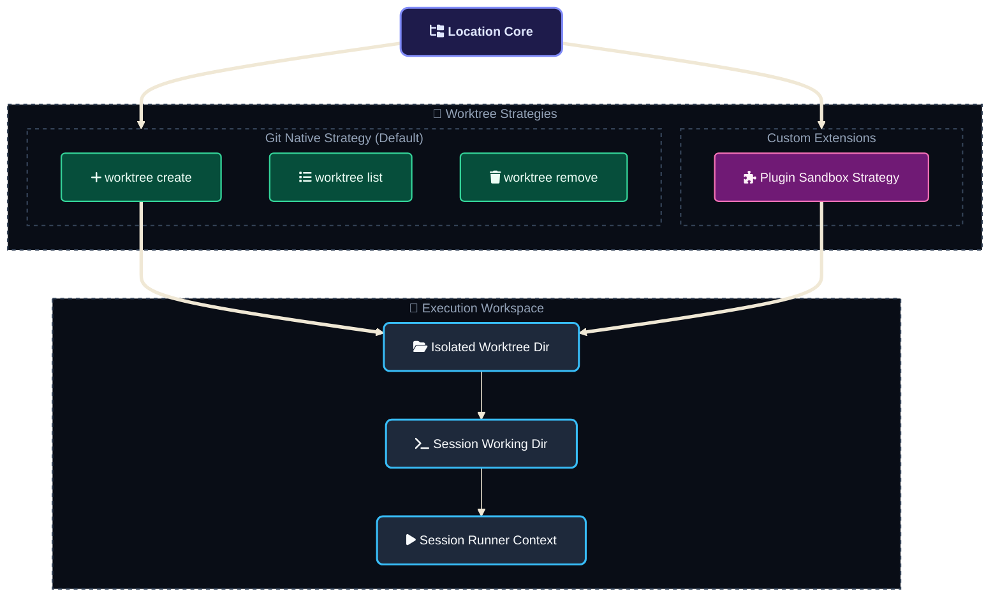

## 14. Event Bus Architecture

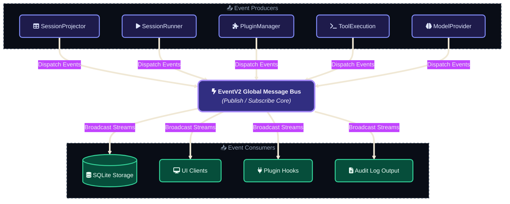

---

*Generated from OpenCode V2 source code and documentation analysis.*
