# OpenCode V2 — Internal Flowcharts

Generated from docs + actual source code analysis (`@opencode-ai/plugin`, `opencode-mem` plugin, `session-rotator`, `opencode.jsonc`).

---

## 1. System Architecture Overview

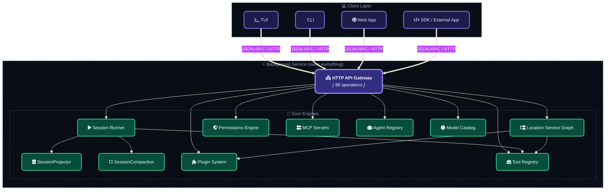

---

## 2. Session Execution Flow (the main loop)

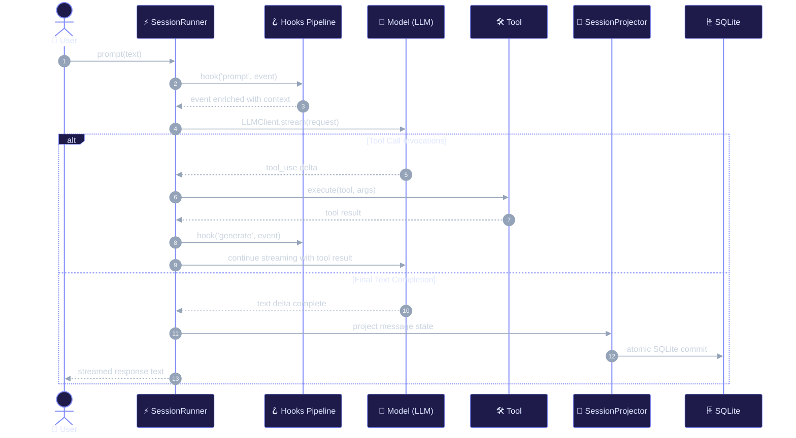

**Hook order (from docs + `opencode-mem` adapter):**

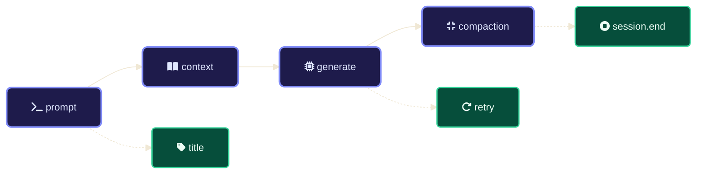

---

## 3. Plugin Transform & Hook Pipeline

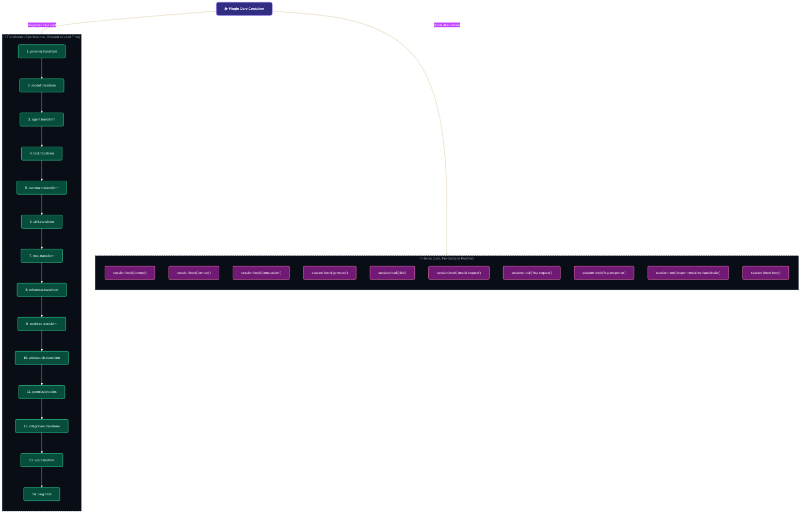

**Real plugin example (opencode-mem adapter):**

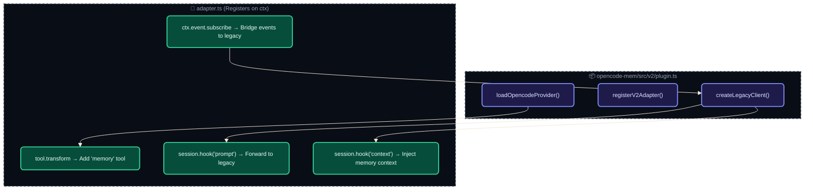

---

## 4. Permission Resolution

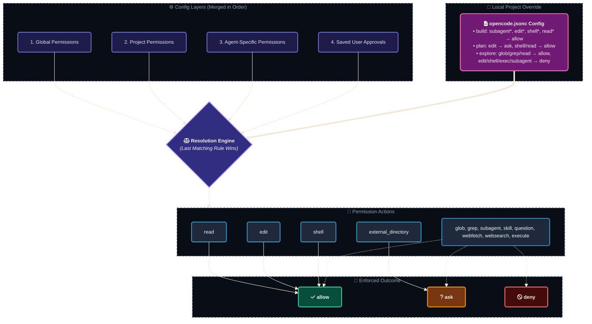

---

## 5. Agent Types & Hierarchy

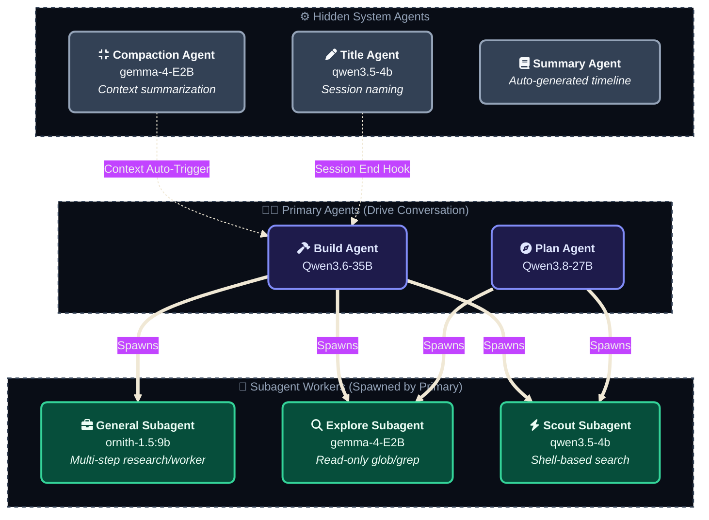

---

## 6. Subagent Execution Model

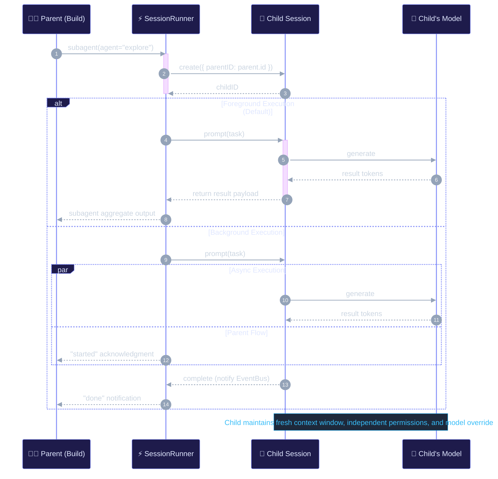

---

## 7. Context Compaction

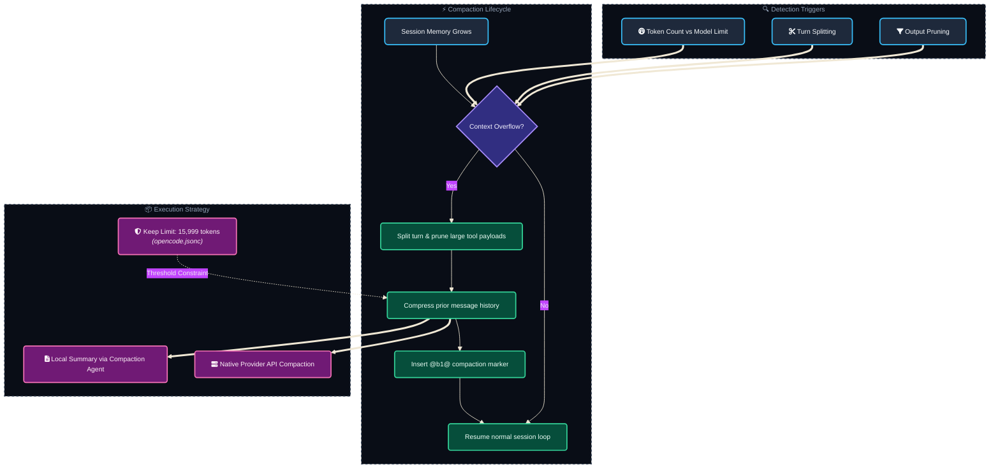

---

## 8. Instruction Resolution Order

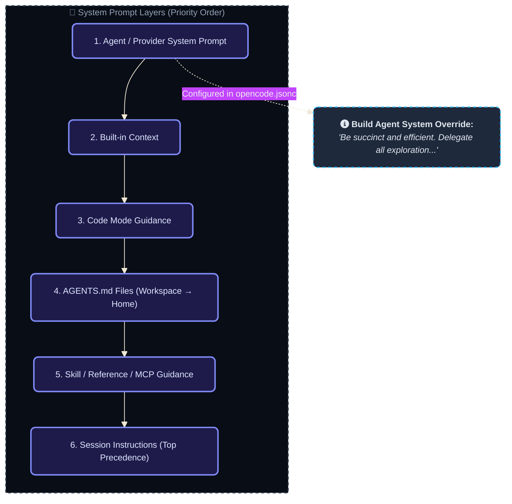

---

## 9. Location Service Graph

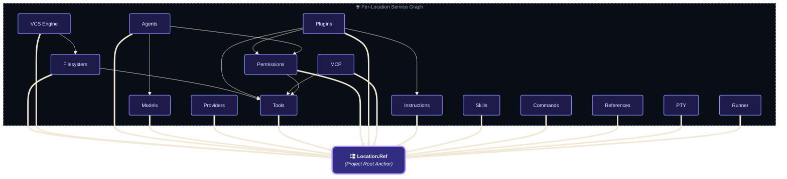

---

## 10. HTTP API Surface (98 operations)

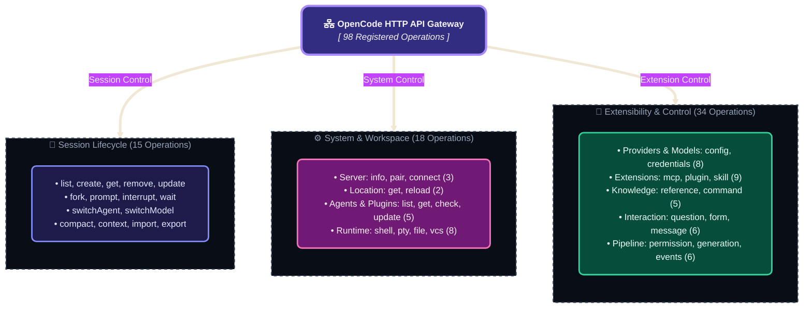

---

## 11. SessionProjector Data Persistence

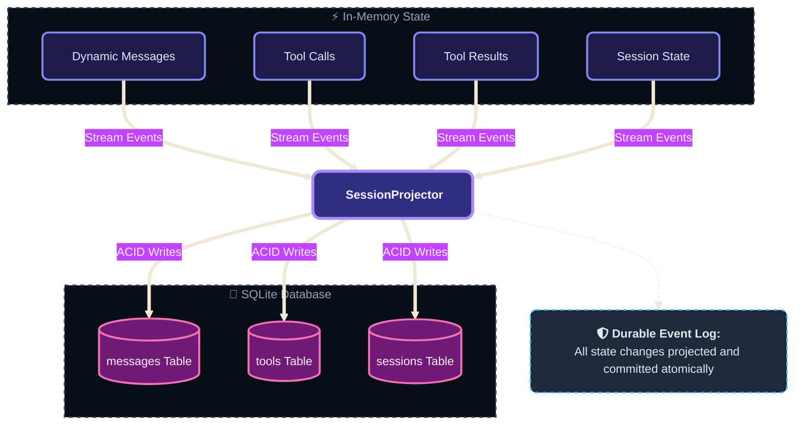

---

## 12. Tool Execution Pipeline

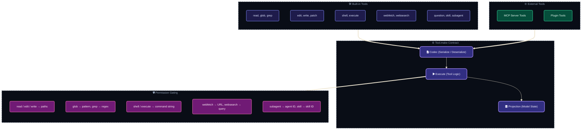

---

## 13. Worktree Management

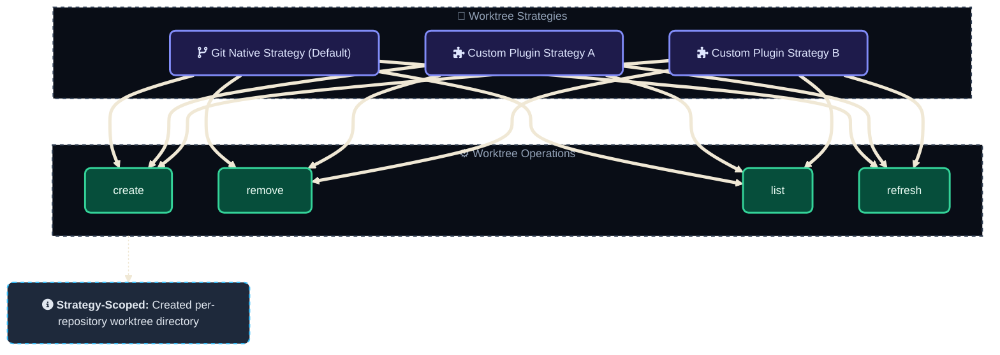

---

## 14. Event Bus Architecture

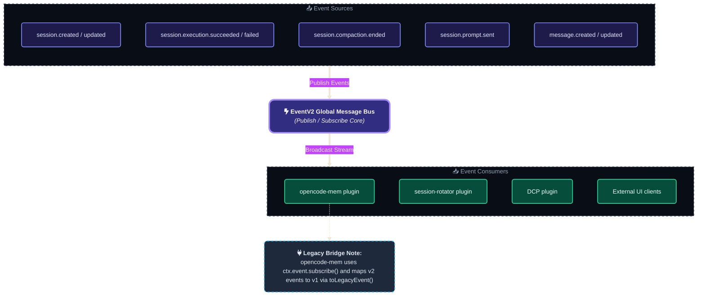

---

## 15. Real Plugin Flow — opencode-mem

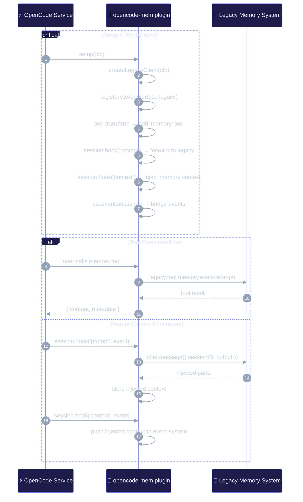

---

## 16. Real Plugin Flow — session-rotator (disabled)

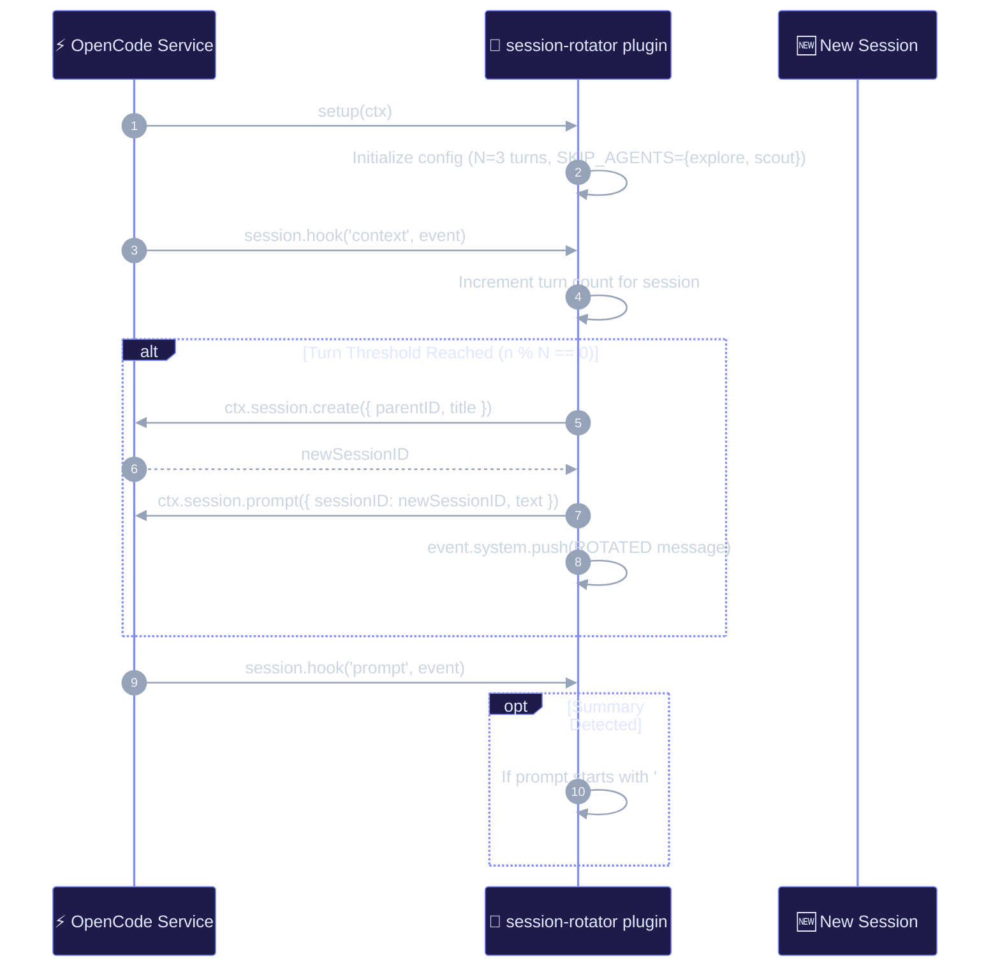

---

## 17. Your Current Agent Permission Matrix

| Agent | Mode | Model | read | edit | shell | glob | grep | subagent | execute |
|---|---|---|---|---|---|---|---|---|---|
| **build** | primary | Qwen3.6-35B | allow | allow | allow | — | — | allow | — |
| **plan** | primary | Qwen3.8-27B | allow | ask | allow | — | — | — | — |
| **general** | subagent | ornith-1.5:9b | — | allow | allow | — | — | — | — |
| **compaction** | subagent | gemma-4-E2B | — | allow | allow | — | — | — | — |
| **title** | subagent | qwen3.5-4b | — | allow | allow | — | — | — | — |
| **explore** | subagent | gemma-4-E2B | allow | deny | deny | allow | allow | deny | deny |
| **scout** | subagent | qwen3.5-4b | allow | deny | allow | allow | allow | deny | deny |

---

## 18. Configuration Merge Order

```mermaid
%%{init: {'theme': 'base', 'themeVariables': { 'fontFamily': 'Fira Code, monospace', 'fontSize': '12px', 'darkMode': true, 'background': '#0f172a'}}}%%
flowchart LR
    classDef base fill:#1e1b4b,stroke:#818cf8,stroke-width:1.5px,color:#e0e7ff,rx:6px,ry:6px;
    classDef priority fill:#701a75,stroke:#f472b6,stroke-width:2px,color:#fdf2f8,rx:6px,ry:6px;
    classDef noteNode fill:#1e293b,stroke:#38bdf8,stroke-width:1.5px,stroke-dasharray: 4 4,color:#e2e8f0,rx:6px,ry:6px;

    A["fa:fa-house Global<br/><i>~/.config/...</i>"]:::base --> B["fa:fa-folder Project<br/><i>project/...</i>"]:::base
    B --> C["fa:fa-folder-gear Local<br/><i>.opencode/...</i>"]:::base
    C --> D["fa:fa-puzzle-piece Plugins<br/><i>Synchronous</i>"]:::base
    D --> E["fa:fa-robot Agent Overrides"]:::base
    E --> F["fa:fa-user-check Saved Approvals<br/><i>Highest Priority</i>"]:::priority

    N1["fa:fa-scale-balanced <b>Resolution Rule:</b> Config merged ancestor → current directory. Last matching permission rule wins."]:::noteNode

    F -.-> N1
```

---

## 19. Prompt → Response Lifecycle

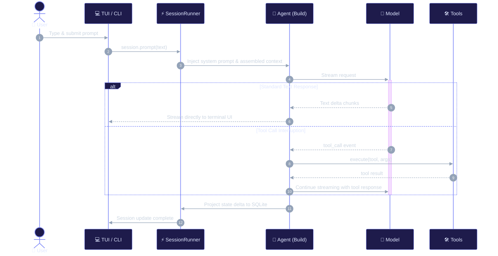

---

## 20. Model Provider Resolution

```mermaid
%%{init: {'theme': 'base', 'themeVariables': { 'fontFamily': 'Fira Code, monospace', 'fontSize': '12px', 'darkMode': true, 'background': '#0f172a'}}}%%
flowchart TB
    classDef provider fill:#1e1b4b,stroke:#818cf8,stroke-width:1.5px,color:#e0e7ff,rx:6px,ry:6px;
    classDef catalog fill:#312e81,stroke:#a78bfa,stroke-width:3px,color:#f5f3ff,rx:8px,ry:8px;
    classDef agent fill:#064e3b,stroke:#34d399,stroke-width:1.5px,color:#ecfdf5,rx:4px,ry:4px;
    classDef noteNode fill:#1e293b,stroke:#38bdf8,stroke-width:1.5px,stroke-dasharray: 4 4,color:#e2e8f0,rx:6px,ry:6px;
    classDef subStyle fill:#090d16,stroke:#334155,stroke-width:1.5px,stroke-dasharray: 4 4,color:#94a3b8;

    subgraph PROVIDERS[" ☁️ Defined Providers (opencode.jsonc) "]
        direction TB
        P1["nerdbook-pro<br/><i>Qwen3.6, Qwen3.8, Qwen3.5</i>"]:::provider
        P2["nerdbook-air<br/><i>gemma-4-12B, gemma-4-E2B</i>"]:::provider
        P3["serenity<br/><i>glm-4.6v-flash</i>"]:::provider
        P4["enterprise<br/><i>ornith-1.5, qwen3.5:4b</i>"]:::provider
        P5["nerdland<br/><i>gemma4:e2b, qwen3.5-4b</i>"]:::provider
    end

    Cat["fa:fa-book-atlas <b>Unified Model Catalog</b><br/><i>(OpenAI-Compatible Abstraction)</i>"]:::catalog

    subgraph AGENTS[" 🤖 Agent Model Routing "]
        direction TB
        A1["build → nerdbook-pro / Qwen3.6"]:::agent
        A2["plan → nerdbook-pro / Qwen3.8"]:::agent
        A3["general → enterprise / ornith-1.5"]:::agent
        A4["compaction → nerdbook-air / gemma-4-E2B"]:::agent
        A5["title → nerdland / qwen3.5-4b"]:::agent
        A6["explore → nerdbook-air / gemma-4-E2B"]:::agent
        A7["scout → nerdland / qwen3.5-4b"]:::agent
    end

    N1["fa:fa-sliders <b>Runtime Overrides:</b> Each agent can override the provider, context window, and temperature."]:::noteNode

    P1 & P2 & P3 & P4 & P5 ==> Cat
    Cat ==> A1 & A2 & A3 & A4 & A5 & A6 & A7
    Cat -.-> N1

    class PROVIDERS,AGENTS subStyle;
```
