# OpenCode V2 — Internal Flowcharts

Generated from docs + actual source code analysis (`@opencode-ai/plugin`, `opencode-mem` plugin, `session-rotator`, `opencode.jsonc`).

---

## 1. System Architecture Overview

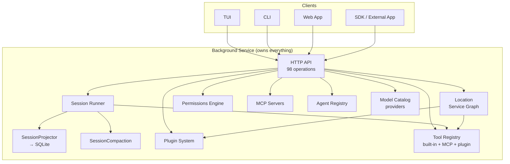

---

## 2. Session Execution Flow (the main loop)

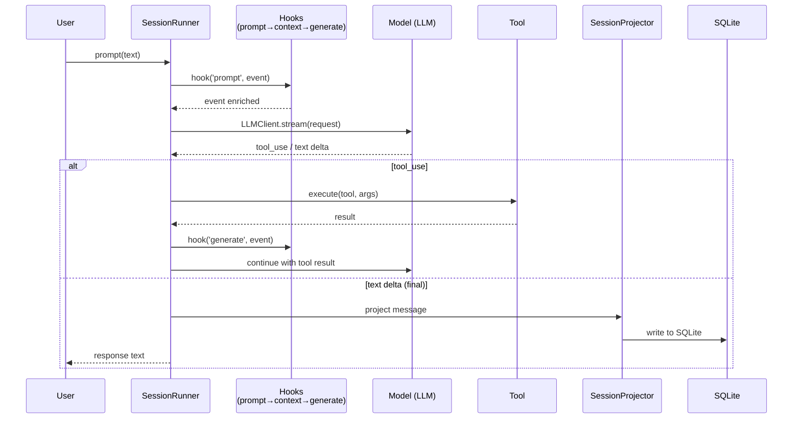

**Hook order (from docs + `opencode-mem` adapter):**

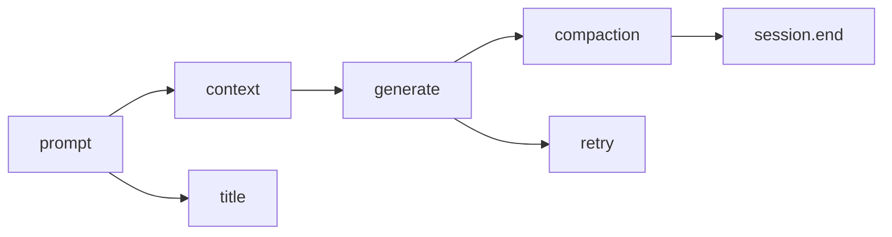

---

## 3. Plugin Transform & Hook Pipeline

```mermaid
graph TB
    subgraph Transforms<br/>Synchronous, ordered at load time
        T1[provider.transform]
        T2[model.transform]
        T3[agent.transform]
        T4[tool.transform]
        T5[command.transform]
        T6[skill.transform]
        T7[mcp.transform]
        T8[reference.transform]
        T9[worktree.transform]
        T10[websearch.transform]
        T11[permission.rules]
        T12[integration.transform]
        T13[vcs.transform]
        T14[plugin.list]
    end

    subgraph Hooks<br/>Live, per-session
        H1[session.hook('prompt')]
        H2[session.hook('context')]
        H3[session.hook('compaction')]
        H4[session.hook('generate')]
        H5[session.hook('title')]
        H6[session.hook('model.request')]
        H7[session.hook('http.request')]
        H8[session.hook('http.response')]
        H9[session.hook('experimental.ws.handshake')]
        H10[session.hook('retry')]
    end

    Plug --> T1 & T2 & T3 & T4 & T5 & T6 & T7 & T8 & T9 & T10 & T11 & T12 & T13 & T14
    Plug --> H1 & H2 & H3 & H4 & H5 & H6 & H7 & H8 & H9 & H10
```

**Real plugin example (opencode-mem adapter):**

```mermaid
graph TB
    subgraph "opencode-mem/src/v2/plugin.ts"
        P1[loadOpencodeProvider]
        P2[registerV2Adapter]
        P3[createLegacyClient]
    end

    subgraph "adapter.ts — registers on ctx"
        A1[tool.transform → add 'memory' tool]
        A2[session.hook('prompt') → forward to legacy]
        A3[session.hook('context') → inject memory context]
        A4[ctx.event.subscribe → bridge events to legacy]
    end

    P3 --> A2 & A3
    P1 --> A1
    A4 --> P3
```

---

## 4. Permission Resolution

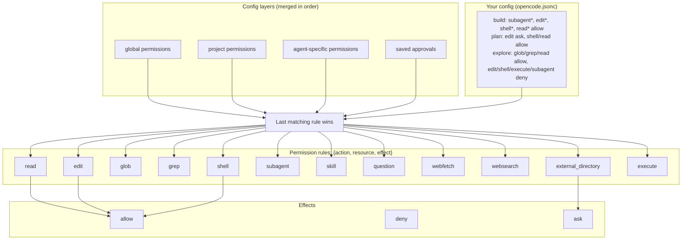

---

## 5. Agent Types & Hierarchy

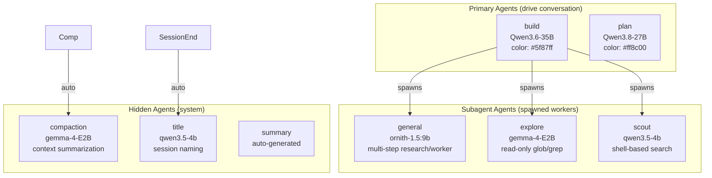

---

## 6. Subagent Execution Model

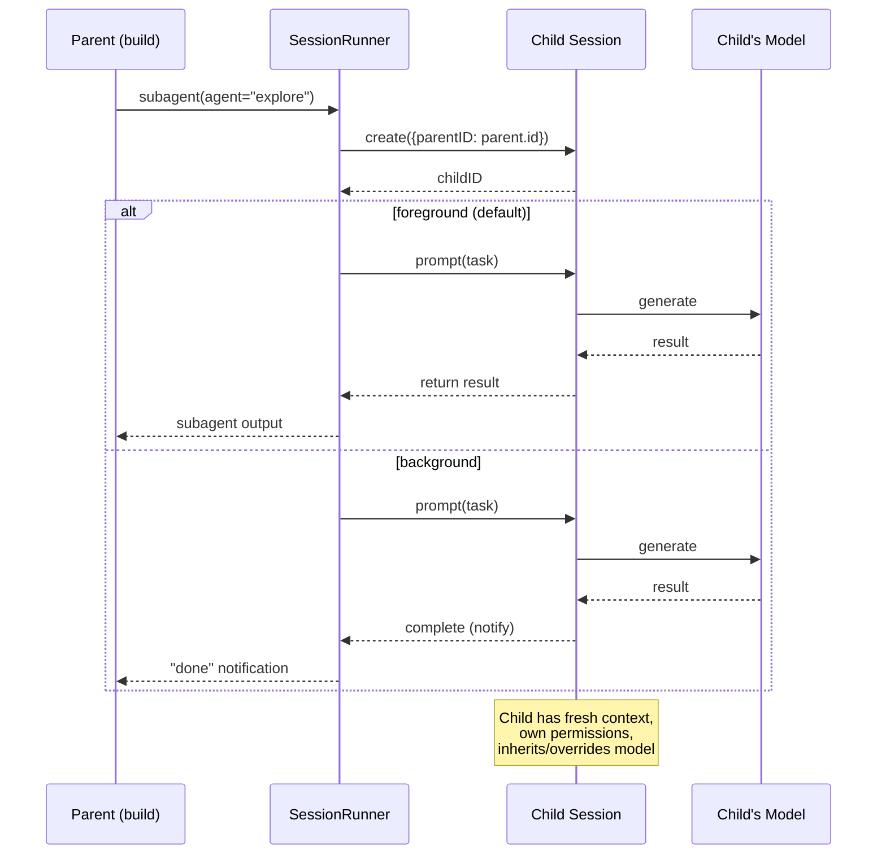

---

## 7. Context Compaction

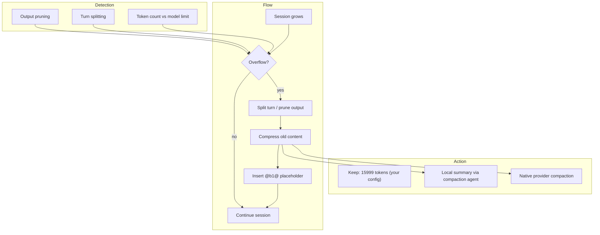

---

## 8. Instruction Resolution Order

```mermaid
graph TB
    subgraph "System prompt layers (priority order)"
        L1[1. Agent/provider system prompt]
        L2[2. Built-in context]
        L3[3. Code Mode guidance]
        L4[4. AGENTS.md files<br/>(workspace → home)]
        L5[5. Skill/reference/MCP guidance]
        L6[6. Session instructions]
    end

    L1 --> L2 --> L3 --> L4 --> L5 --> L6

    Note: Your build agent has custom system prompt:<br/>
    "Be succinct and efficient. Delegate all exploration..."
```

---

## 9. Location Service Graph

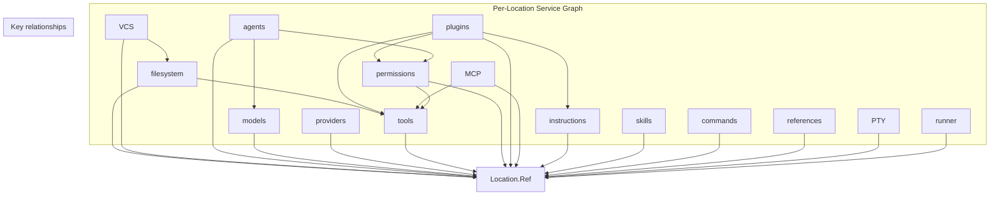

---

## 10. HTTP API Surface (98 operations)

```mermaid
graph TB
    subgraph "Resource Groups"
        SV[server<br/>info, pair, connect]
        LC[location<br/>get, reload]
        AG[agent<br/>list, get]
        PL[plugin<br/>list, check, update]
        SE[session<br/>list, create, get, remove,<br/>update, fork, prompt,<br/>interrupt, wait,<br/>switchAgent, switchModel,<br/>compact, context,<br/>import/export]
        MS[message]
        FM[form]
        QS[question]
        PM[permission<br/>list, approve, deny]
        FI[file]
        VC[vcs]
        SH[shell]
        PT[pty]
        MO[model<br/>list, info]
        PV[provider]
        IG[integration]
        CR[credential]
        MP[mcp<br/>list, add, remove]
        SK[skill]
        RF[reference]
        CM[command]
        GE[generation]
        EV[event]
    end

    SV & LC & AG & PL & SE & MS & FM & QS & PM & FI & VC & SH & PT & MO & PV & IG & CR & MP & SK & RF & CM & GE & EV --> API[HTTP API]
```

---

## 11. SessionProjector Data Persistence

```mermaid
graph TB
    subgraph "In-memory"
        Msg[Messages]
        TC[Tool Calls]
        TR[Tool Results]
        St[State]
    end

    subgraph "Projection"
        Proj[SessionProjector]
        Sql[SQLite]
    end

    Msg --> Proj
    TC --> Proj
    TR --> Proj
    St --> Proj

    Proj --> MsgDB[(messages table)]
    Proj --> ToolDB[(tools table)]
    Proj --> SessionDB[(sessions table)]

    Note: Durable event log. All changes projected atomically.
```

---

## 12. Tool Execution Pipeline

```mermaid
graph TB
    subgraph "Tool.make contract"
        Codec[Codec<br/>serialize/deserialize]
        Exec[Execute<br/>run the tool]
        Proj[Optional model projection]
    end

    subgraph "Built-in Tools"
        T1[read]
        T2[glob]
        T3[grep]
        T4[edit]
        T5[write]
        T6[patch]
        T7[shell]
        T8[webfetch]
        T9[websearch]
        T10[question]
        T11[skill]
        T12[subagent]
        T13[execute]
    end

    subgraph "MCP Tools"
        MC1[MCP server 1 tools]
        MC2[MCP server 2 tools]
    end

    subgraph "Plugin Tools"
        PL1[plugin tool 1]
        PL2[plugin tool 2]
    end

    Codec --> Exec --> Proj
    T1 & T2 & T3 & T4 & T5 & T6 & T7 & T8 & T9 & T10 & T11 & T12 & T13 --> Codec
    MC1 & MC2 --> Codec
    PL1 & PL2 --> Codec

    subgraph "Permission gating"
        PermRead[read → path]
        PermEdit[edit → edit/write/patch paths]
        PermGlob[glob → pattern]
        PermGrep[grep → regex]
        PermShell[shell → command string]
        PermSub[subagent → agent ID]
        PermSkill[skill → skill ID]
        PermQ[question → *]
        PermFetch[webfetch → URL]
        PermSearch[websearch → query]
        PermExt[external_directory → dir boundary]
        PermExec[execute → *]
    end

    Exec --> PermRead & PermEdit & PermGlob & PermGrep & PermShell & PermSub & PermSkill & PermQ & PermFetch & PermSearch & PermExt & PermExec
```

---

## 13. Worktree Management

```mermaid
graph TB
    subgraph "Worktree Strategies"
        Git[Git (default)]
        P1[Plugin strategy 1]
        P2[Plugin strategy 2]
    end

    subgraph "Operations"
        C[create]
        R[remove]
        L[list]
        F[refresh]
    end

    Git & P1 & P2 --> Ops[C & R & L & F]

    Note: Strategy-scoped. Created per-repository.
```

---

## 14. Event Bus Architecture

```mermaid
graph TB
    subgraph "EventV2 — Global Event Bus"
        EV[EventV2]
    end

    subgraph "Event Sources"
        ES1[session.created]
        ES2[session.updated]
        ES3[session.execution.succeeded]
        ES4[session.execution.failed]
        ES5[session.compaction.ended]
        ES6[session.prompt.sent]
        ES7[message.created]
        ES8[message.updated]
    end

    subgraph "Event Consumers"
        EC1[opencode-mem plugin]
        EC2[session-rotator plugin]
        EC3[DCP plugin]
        EC4[external clients]
    end

    ES1 & ES2 & ES3 & ES4 & ES5 & ES6 & ES7 & ES8 --> EV

    EV --> EC1
    EV --> EC2
    EV --> EC3
    EV --> EC4

    Note: opencode-mem uses ctx.event.subscribe() to listen<br/>and bridges v2 events to v1-compatible format via toLegacyEvent()
```

---

## 15. Real Plugin Flow — opencode-mem

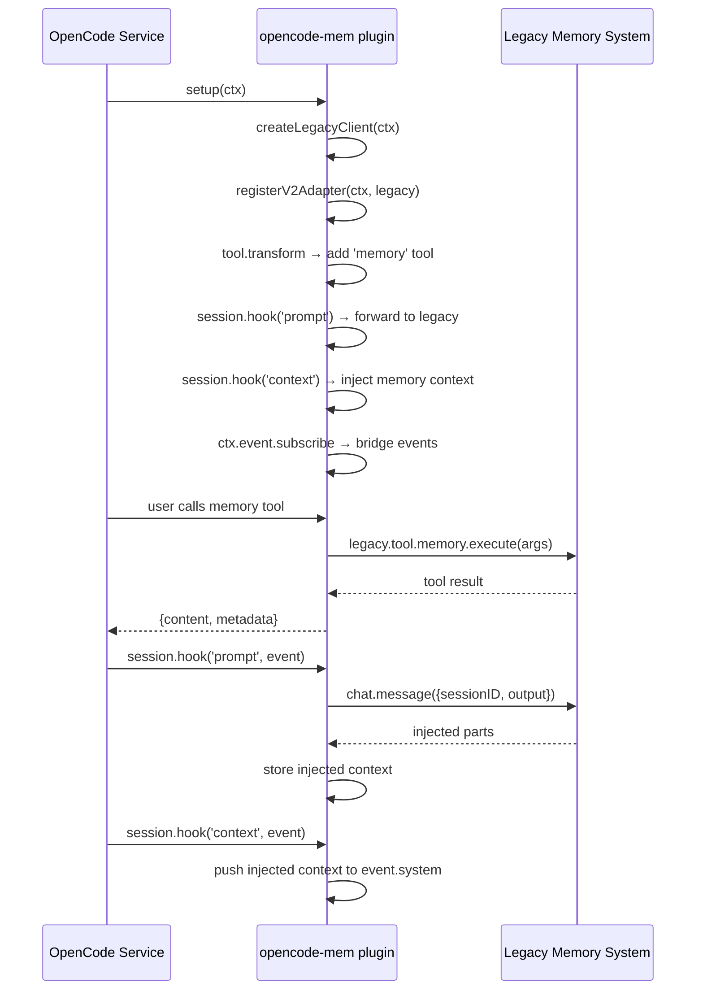

---

## 16. Real Plugin Flow — session-rotator (disabled)

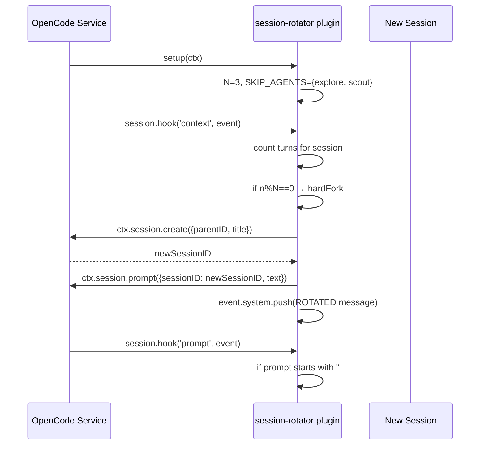

---

## 17. Your Current Agent Permission Matrix

| Agent | Mode | Model | read | edit | shell | glob | grep | subagent | execute |
|-------|------|-------|------|------|-------|------|------|----------|---------|
| **build** | primary | Qwen3.6-35B | allow | allow | allow | — | — | allow | — |
| **plan** | primary | Qwen3.8-27B | allow | ask | allow | — | — | — | — |
| **general** | subagent | ornith-1.5:9b | — | allow | allow | — | — | — | — |
| **compaction** | subagent | gemma-4-E2B | — | allow | allow | — | — | — | — |
| **title** | subagent | qwen3.5-4b | — | allow | allow | — | — | — | — |
| **explore** | subagent | gemma-4-E2B | allow | deny | deny | allow | allow | deny | deny |
| **scout** | subagent | qwen3.5-4b | allow | deny | allow | allow | allow | deny | deny |

---

## 18. Configuration Merge Order

```mermaid
graph LR
    A[~/.config/opencode/opencode.jsonc<br/>global] --> B[project/opencode.jsonc<br/>project-local]
    B --> C[.opencode/opencode.jsonc<br/>project/.opencode]
    C --> D[plugin transforms<br/>synchronous]
    D --> E[agent-specific rules<br/>override]
    E --> F[saved approvals<br/>runtime]

    Note: Last matching rule wins for permissions.
    Note: Config merged farthest ancestor → current directory.
```

---

## 19. Prompt → Response Lifecycle

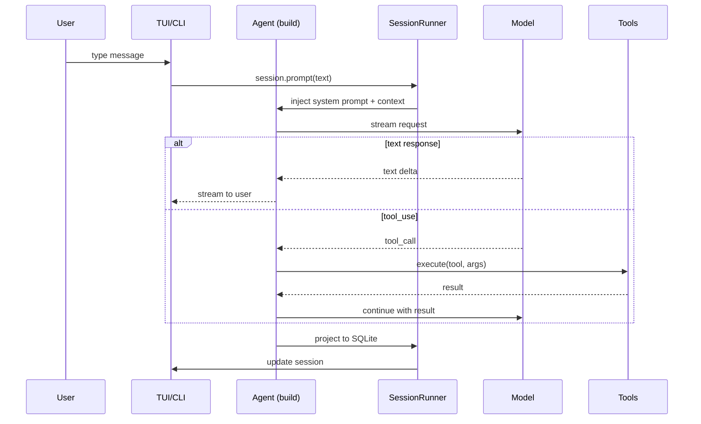

---

## 20. Model Provider Resolution

```mermaid
graph TB
    subgraph "Providers (opencode.jsonc)"
        P1[nerdbook-pro<br/>Qwen3.6, Qwen3.8, Qwen3.5]
        P2[nerdbook-air<br/>gemma-4-12B, gemma-4-E2B]
        P3[serenity<br/>glm-4.6v-flash]
        P4[enterprise<br/>ornith-1.5, qwen3.5:4b]
        P5[nerdland<br/>gemma4:e2b, qwen3.5-4b]
    end

    subgraph "Agent model assignment"
        A1[build → nerdbook-pro/Qwen3.6]
        A2[plan → nerdbook-pro/Qwen3.8]
        A3[general → enterprise/ornith-1.5]
        A4[compaction → nerdbook-air/gemma-4-E2B]
        A5[title → nerdland/qwen3.5-4b]
        A6[explore → nerdbook-air/gemma-4-E2B]
        A7[scout → nerdland/qwen3.5-4b]
    end

    P1 & P2 & P3 & P4 & P5 --> Cat[Model Catalog]
    Cat --> A1 & A2 & A3 & A4 & A5 & A6 & A7

    Note: Each agent can override the default model.
    Note: Providers use OpenAI-compatible format.
```
